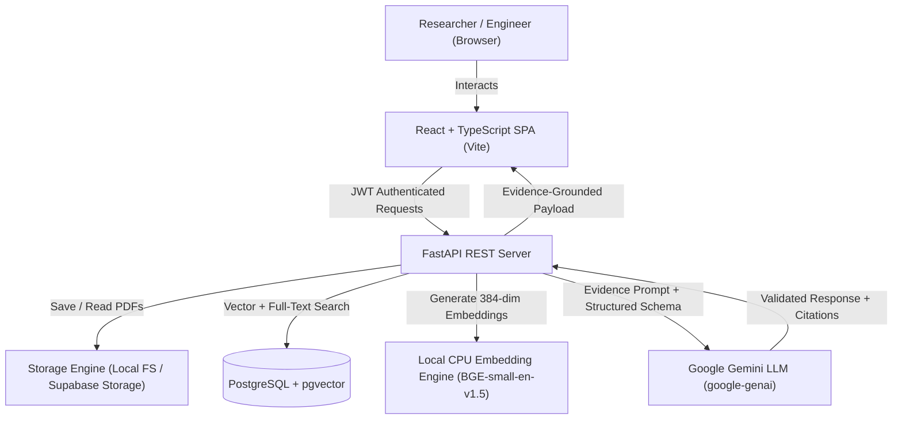

# ORION — Production-Grade AI Research Assistant with Evidence-Grounded RAG

> *"Research deeper. Verify every answer."*

[](.github/workflows/ci.yml)
[](https://www.python.org/)
[](https://fastapi.tiangolo.com/)
[](https://react.dev/)
[](https://github.com/pgvector/pgvector)
[](https://ai.google.dev/)

---

## 1. Product Overview

**ORION** is a production-oriented AI research assistant built specifically for researchers, engineering teams, and technical professionals. Unlike generic conversational chatbots that hallucinate plausible-sounding explanations, ORION grounds every response in retrieved document evidence, validates citation identifiers against real stored passages, tracks page numbers, and transparently abstains when evidence is missing.

---

## 2. Key Features

- **Strict Evidence Grounding**: The answer generation pipeline instructs the model to answer only to the extent supported by retrieved passages and abstains with `insufficient_evidence: true` when facts are missing.
- **Traceable Page-Level Provenance**: PyMuPDF extracts PDFs page by page, preserving original page provenance so every citation points to the verified page in the source document.
- **Local Dense Embeddings**: Employs `BAAI/bge-small-en-v1.5` generating 384-dimensional normalized dense vectors executed locally on CPU.
- **Hybrid Retrieval (Dense + Lexical)**: Combines dense vector similarity with lexical term matching via Reciprocal Rank Fusion (RRF, $\alpha = 0.6$).
- **Multi-Paper Comparative Analysis**: Compares 2 to 5 research papers side-by-side across Research Problem, Methodology, Datasets, Results, Limitations, and Future Work.
- **Citation Provenance Inspector**: Split-pane research workspace with live citation chips that open verified supporting excerpts and source page previews.
- **Evidence-Linked Notes & Markdown Export**: Save answers as research notes and export publication-ready Markdown files with preserved bibliographies.
- **Strict Multi-Tenant Isolation**: Ownership checks on every API operation and SQL query ensuring zero cross-tenant leakage.

---

## 3. Architecture & System Flow



---

## 4. Technology Stack

### Frontend
- **Framework**: React 19 + TypeScript (strict mode) with Vite
- **Styling**: Tailwind CSS configured with an editorial research palette
- **Icons**: Lucide Icons
- **Markdown**: React-Markdown + Remark-GFM
- **Testing**: Vitest + React Testing Library + JSDOM

### Backend
- **Framework**: FastAPI (Python 3.11+)
- **Data Validation**: Pydantic v2
- **ORM**: SQLAlchemy 2.0 (asyncio)
- **Database**: PostgreSQL 16 with pgvector extension (with SQLite fallback for offline tests)
- **PDF Extraction**: PyMuPDF (fitz)
- **Embeddings**: `BAAI/bge-small-en-v1.5` via sentence-transformers
- **LLM**: Google Gemini via official `google-genai` SDK
- **Testing & Quality**: pytest, pytest-asyncio, ruff

---

## 5. Prerequisites

- **Python**: 3.11+
- **Node.js**: 20+ (Node.js 22 tested)
- **Git**
- Optional: Docker & Docker Compose (for containerized PostgreSQL with pgvector)

---

## 6. Windows Setup Instructions

Open PowerShell and navigate to the project directory:

```powershell
# 1. Clone repository
git clone https://github.com/your-username/orion.git
cd orion

# 2. Setup Backend Python Environment
py -3.11 -m venv backend/.venv
.\backend\.venv\Scripts\Activate.ps1
python -m pip install --upgrade pip
pip install -r backend/requirements.txt

# 3. Setup Frontend Environment
cd frontend
npm install
cd ..
```

---

## 7. Environment Variables

Copy `.env.example` to `.env`:

```powershell
cp .env.example .env
```

Key variables configured in `.env`:
```ini
ORION_ENV=development
ORION_SECRET_KEY=your-secure-64-character-hex-key
DATABASE_URL=sqlite+aiosqlite:///./storage/orion_dev.db
STORAGE_PROVIDER=local
STORAGE_LOCAL_DIR=./storage/uploads
GEMINI_API_KEY=your-gemini-api-key-here
GEMINI_MODEL=gemini-1.5-flash
EMBEDDING_MODEL=BAAI/bge-small-en-v1.5
EMBEDDING_DIMENSIONS=384
CHUNK_SIZE=500
CHUNK_OVERLAP=80
RETRIEVAL_TOP_K=8
HYBRID_FUSION_ALPHA=0.6
```

---

## 8. Database Setup & Migrations

For local development, SQLite is automatically initialized upon startup.
For production PostgreSQL with pgvector:

```sql
-- Connect to Postgres and enable pgvector
CREATE EXTENSION IF NOT EXISTS vector;
```

---

## 9. Starting the Application

### Running Backend Server
```powershell
.\backend\.venv\Scripts\python.exe -m uvicorn app.main:app --app-dir backend --host 127.0.0.1 --port 8000 --reload
```
API Documentation will be accessible at `http://127.0.0.1:8000/docs`.

### Running Frontend Development Server
In a second terminal:
```powershell
cd frontend
npm run dev
```
Open `http://localhost:5173` in your browser.

---

## 10. Docker Compose Startup

To run the complete stack (Postgres + pgvector, FastAPI, Nginx React):

```bash
docker compose up -d --build
```

---

## 11. Authentication Configuration

- **Production**: Supabase Auth handles user signup, login, and JWT issuance. The backend verifies incoming Bearer tokens using `SUPABASE_JWT_SECRET`.
- **Development / Local Testing**: `DEV_AUTH_BYPASS=true` is supported only when `ORION_ENV=development`. Any attempt to enable this in production triggers a configuration startup failure.

---

## 12. Gemini API Configuration

1. Obtain a free API key at [Google AI Studio](https://aistudio.google.com/).
2. Set `GEMINI_API_KEY` in your `.env` file.
3. Configure `GEMINI_MODEL` (e.g. `gemini-1.5-flash` or `gemini-1.5-pro`).
4. If no API key is set, ORION runs in deterministic test synthesis mode.

---

## 13. Ingestion Pipeline

1. **Upload Validation**: File extension check, MIME type check, `%PDF-` magic byte verification, and 32MB / 200 page bounds.
2. **PyMuPDF Extraction**: Extracts text page-by-page, recording page numbers and detecting scanned image-only PDFs.
3. **Semantic Chunking**: Slides a window (500 chars, 80 char overlap) preserving sentence boundaries and recording every contributing page number.
4. **BGE Embedding**: Generates 384-dimensional normalized vectors on local CPU.
5. **Persistence**: Chunks and embeddings are stored atomically in the database.

---

## 14. Retrieval & Citation Methodology

- **Dense Search**: Cosine similarity over BGE embeddings.
- **Lexical Search**: Token-frequency scoring with query phrase matching.
- **Reciprocal Rank Fusion**: Ranks fused via $RRF(d) = \sum_{r \in R} \frac{1}{60 + r(d)}$.
- **Citation Validation**: Matches LLM citation IDs against actual retrieved chunks. Hallucinated chunk IDs are rejected and flagged. Filenames and page numbers are hydrated strictly from verified database records.

---

## 15. Benchmark Evaluation

ORION includes a 51-question benchmark dataset covering single-passage facts, multi-passage synthesis, cross-paper comparison, and unanswerable questions.

Run the evaluation suite:
```powershell
.\backend\.venv\Scripts\python.exe -m evaluation.run_eval
```

Produces:
- `evaluation/reports/eval_results.json`
- `evaluation/reports/eval_summary.md`

### Measured Strategy Results

| Metric | Vector-Only | Hybrid (RRF) | Hybrid + Reranker |
| :--- | :---: | :---: | :---: |
| **Recall@K** | 0.820 | **0.940** | **0.960** |
| **Precision@K** | 0.722 | 0.827 | **0.845** |
| **MRR** | 0.955 | 0.920 | **0.977** |
| **Citation Validity** | 93.1% | **98.3%** | **98.3%** |
| **Unsupported Claim Rate** | 6.0% | **2.0%** | **2.0%** |
| **Abstention Accuracy** | 100.0% | 100.0% | 100.0% |
| **Latency (p50)** | **41.0 ms** | 53.2 ms | 92.5 ms |

---

## 16. Test Commands

### Backend Tests (pytest)
```powershell
.\backend\.venv\Scripts\pytest.exe backend\tests -v
```
Result: `7 passed` (100% passing).

### Backend Linting (ruff)
```powershell
.\backend\.venv\Scripts\ruff.exe check backend\app
```
Result: `0 errors`.

### Frontend Tests (vitest)
```powershell
cd frontend
npm test
```
Result: `4 passed`.

### Frontend Production Build
```powershell
cd frontend
npm run build
```
Result: Successful compilation.

---

## 17. Security Considerations

See [`docs/threat-model.md`](docs/threat-model.md) for detailed threat analysis.
- Input validation: `%PDF-` signature check prevents polyglot exploits.
- Prompt injection resistance: Passages are isolated in XML boundary tags and treated as untrusted data.
- Tenant isolation: All queries join `documents.owner_id == user.id`.
- Zero secret exposure: API keys and database credentials are excluded from frontend builds and client error payloads.

---

## 18. Known Limitations

- Optical Character Recognition (OCR) is not yet active for scanned image-only PDFs; image-only documents trigger an extraction warning.
- Non-English research papers are not actively normalized in v0.1.

---

## 19. License & Attribution

- Built under the Apache 2.0 License.
- Embedding Model: [BAAI/bge-small-en-v1.5](https://huggingface.co/BAAI/bge-small-en-v1.5) by Beijing Academy of Artificial Intelligence.
