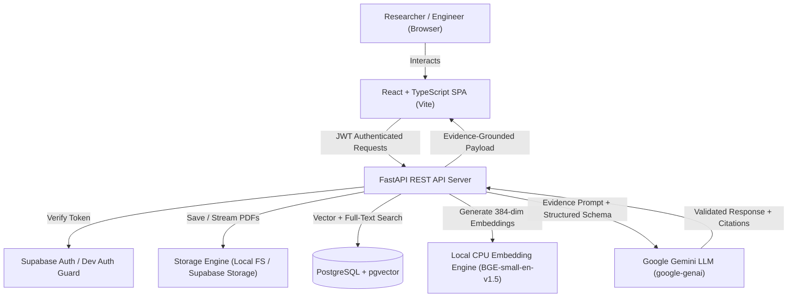
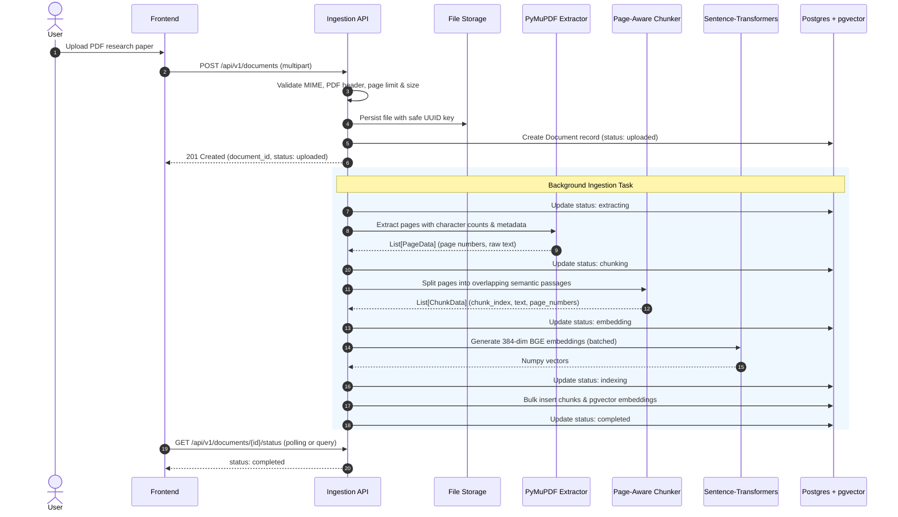

# ORION — Architecture & System Design

> "Research deeper. Verify every answer."

ORION is a production-grade AI research assistant engineered for high reliability, verifiable evidence-grounded RAG (Retrieval-Augmented Generation), strict page-level citation provenance, and transparent abstention when evidence is insufficient.

---

## 1. High-Level Architecture Overview

ORION is architected as a modular monorepo cleanly separated into:
1. **Frontend**: Vite + React 19 + TypeScript (strict mode), Tailwind CSS, TanStack Query, React Router, Lucide icons, safe Markdown renderer.
2. **Backend**: FastAPI (Python 3.11+), Pydantic v2 schemas, SQLAlchemy 2.0 ORM, Alembic migrations, PyMuPDF page extractor, sentence-transformers (`BAAI/bge-small-en-v1.5`), and Google Gemini via official `google-genai` SDK.
3. **Database & Storage**: PostgreSQL with `pgvector` for vector embeddings, full-text search indexes (`tsvector`), Supabase Auth/Storage support, and local filesystem/SQLite fallback for zero-dependency development/testing.
4. **Evaluation Engine**: Automated benchmark suite with 50+ curated evaluation questions, measuring Recall@K, MRR, answer faithfulness, citation validity, and latency.



---

## 2. Ingestion Pipeline Architecture

The ingestion pipeline guarantees strict page-level provenance. It never concatenates the whole document into an opaque text blob.



---

## 3. Evidence-Grounded Hybrid Retrieval & Answer Generation

The core promise of ORION is: **"ORION must never pretend that an answer is supported when the retrieved evidence does not support it."**

```mermaid
flowchart TD
    Q[User Question + Collection / Document Filter] --> Auth[Authorization & Scope Verification]
    Auth --> Rewrite[Query Handling & Sanitation]
    
    subgraph Hybrid Retrieval
        Rewrite --> Dense[Dense Vector Search (Cosine Similarity)]
        Rewrite --> Sparse[Lexical Full-Text Search (ts_rank)]
        Dense --> Fusion[Reciprocal Rank Fusion (RRF)]
        Sparse --> Fusion
    end

    Fusion --> TopK[Top-K Passage Deduplication & Diversity Filtering]
    TopK --> Context[Context Assembly with Trusted Provenance IDs]
    Context --> Prompt[Strict Evidence-Grounded Prompting]
    
    Prompt --> LLM[Gemini 1.5 Flash / Pro via google-genai]
    LLM --> Structured[Pydantic Schema Validation]
    
    Structured --> CitationCheck{Citation Validation Engine}
    CitationCheck -->|Matches Retrieved Chunks| Verified[Mark Validated Citations]
    CitationCheck -->|Hallucinated / Missing ID| Flag[Flag Unsupported & Warn]
    
    Verified --> Result[Evidence Payload Delivered to Client]
    Flag --> Result
```

---

## 4. Citation Validation Rules

1. **Existence Verification**: Every citation ID generated by the model is matched against the actual set of retrieved chunk IDs passed in the context.
2. **Metadata Integrity**: Filenames and page numbers are reconstructed strictly from trusted database records, never from model-invented strings.
3. **Claim Association**: Claims in the response are categorized as `supported`, `partially_supported`, or `unsupported`.
4. **Abstention Protocol**: If the hybrid retrieval returns no passages above relevance threshold, or the model determines the text is insufficient, `insufficient_evidence: true` is returned immediately without hallucinating facts.
