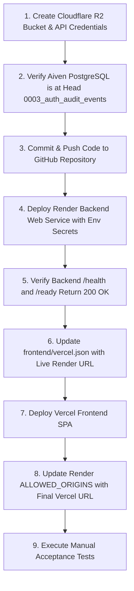
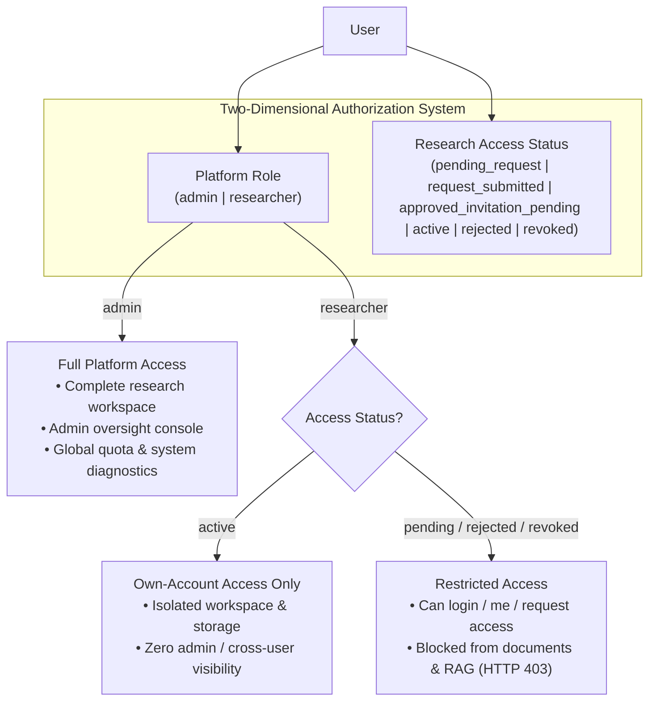

# ORION — Final Production Deployment Preflight Audit

**Audit Date:** 2026-11-05  
**Auditor:** Senior DevOps Engineer & Autonomous Cloud Infrastructure Architect  
**Status:** **CONDITIONAL GO** (Ready for deployment pending platform variable entry & Git commit)  
**Target Architecture:**
- **Frontend:** Vercel (Edge SPA with API proxy rewrite)
- **Backend:** Render (Docker Web Service, starter/standard plan)
- **Database:** Aiven PostgreSQL 18.6 with `pgvector` (SSL required)
- **Object Storage:** Cloudflare R2 (S3-compatible, private bucket)
- **AI / LLM:** Google Gemini API (`gemini-3.5-flash-lite`)

---

## 1. Executive Summary

This preflight audit evaluates the complete ORION repository for its initial public deployment. All core architectural components, security controls, multi-user isolation mechanisms, S3 storage abstractions, background worker lifecycles, and database constraints were inspected.

### Preflight Readiness Scorecard

| Area | Status | Critical Findings |
| :--- | :---: | :--- |
| **Backend Docker & Runtime** | 🟢 **READY** | Multi-stage Dockerfile, CPU PyTorch, pre-cached embedding model (`BAAI/bge-small-en-v1.5`), unprivileged UID 1000, dynamic `$PORT` binding. |
| **Frontend Vercel Configuration** | 🟡 **BLOCKED** | Edge rewrite configured, but destination placeholder `https://orion-backend.onrender.com` must be updated with the live Render URL before deployment. |
| **Production Configuration Validation** | 🟢 **READY** | `validate_production_requirements()` enforces non-dev `SECRET_KEY`, PostgreSQL database, valid Gemini key, public `ALLOWED_ORIGINS`, and S3 credentials on boot. |
| **Aiven PostgreSQL & Alembic Head** | 🟢 **READY** | Connection requires SSL (`ssl=require`). Expected Alembic head is strictly `0003_auth_audit_events`. Engine fails fast if schema differs. |
| **Cloudflare R2 Object Storage** | 🟢 **READY** | S3-compatible `S3StorageService` configured for R2. Bucket readiness probe integrated into `/ready`. Bucket must remain strictly private. |
| **Durable Ingestion Worker** | 🟢 **READY** | Runs continuously inside the backend web container via FastAPI lifespan. Concurrency safety ensured via `FOR UPDATE SKIP LOCKED`. |
| **HTTPS, Cookies, CORS & CSRF** | 🟢 **READY** | `SameSite=Lax`, `HttpOnly` session cookie, Double Submit CSRF cookie/header, HSTS headers, strict CORS origin validation. |
| **Admin & Role Access Control** | 🟢 **READY** | `orionadmin@gmail.com` configured in `ADMIN_EMAILS`. All `/admin/*` endpoints guarded by `require_admin_user`. |
| **Gemini Resilience & Latency** | 🟢 **READY** | Bounded retries (`GEMINI_MAX_RETRIES=1`), 12s timeout (`GEMINI_TIMEOUT_SECONDS=12.0`), deterministic citation fallback active on 503/timeout. |
| **Local Path & SQLite Protection** | 🟢 **READY** | Hard failure on boot if `sqlite` in `DATABASE_URL` or `local` in `STORAGE_PROVIDER` when `ENVIRONMENT=production`. |
| **Test Suites & Production Build** | 🟢 **READY** | Frontend Vitest: **102/102 passed**. Frontend Build: **0 errors**. Backend Pytest: **37/37 passed** across auth, admin, and resilience suites. |

---

## 2. Preflight Item Status: READY vs. BLOCKED

### 🟢 READY Items (Code & Architecture Complete)
1. **Dynamic Port Binding:** `backend/Dockerfile` uses `exec uvicorn app.main:app --host 0.0.0.0 --port ${PORT:-8000}`. `backend/app/core/config.py` dynamically resolves `$PORT` injected by Render.
2. **Signal Propagation & Graceful Shutdown:** `exec` preserves `SIGTERM` delivery to Python, triggering clean ingestion worker shutdown and job checkpointing in FastAPI lifespan.
3. **Embedding Model Baking:** `SentenceTransformer('BAAI/bge-small-en-v1.5')` is pre-downloaded during Docker build into `/opt/huggingface`, preventing Cold-Start timeouts or Hugging Face rate limits at runtime.
4. **Database Migration Revision Safety:** `backend/app/db/session.py` checks `version_num == "0003_auth_audit_events"` on startup. The live Aiven database was migrated to `0003_auth_audit_events`.
5. **Storage Abstraction & Multi-User Isolation:** `S3StorageService` routes all document uploads and page renders to S3 keys namespaced by `user_id`: `{user_id}/{doc_id}/{filename}`. Database triggers enforce tenant isolation.
6. **Cumulative Per-User Quota:** Centralized 500 MB limit (`USER_STORAGE_QUOTA_MB=500`) enforced atomically across single and batch uploads.
7. **Gemini 503 Bounded Retries:** Timeout clamped to 12s, max 1 retry with exponential backoff (max total wait 5s), fallback to deterministic research citation response.
8. **Role-Based Experience Separation:** Researcher Settings (`SettingsView`) separated from Administrator Console (`AdminDashboardView` / `AdminSystemDiagnosticsView`). Internal UUIDs hidden from researchers.
9. **Automated Verification:** All test suites passing (`102` vitest tests, `26` auth/admin pytest tests, `11` resilience pytest tests).

---

### 🔴 BLOCKED Items (Operational Steps Before Live Public Traffic)

These items require manual operational configuration in platform dashboards before the application can receive live public traffic:

| Item | Blocked By | Action Required |
| :--- | :--- | :--- |
| **1. Uncommitted Git Changes** | Local repository has modified and untracked files | Commit and push all validated changes to the deployment branch on GitHub. Both Render and Vercel build from Git. |
| **2. Vercel Rewrite URL Placeholder** | `frontend/vercel.json` contains `https://orion-backend.onrender.com` | After creating the Render web service, obtain the exact service URL (e.g., `https://orion-backend-xxxx.onrender.com`) and update `frontend/vercel.json`. |
| **3. Render Secret Environment Variables** | Render Web Service requires 7 manual secrets | Enter `DATABASE_URL`, `GEMINI_API_KEY`, `S3_ENDPOINT_URL`, `S3_ACCESS_KEY_ID`, `S3_SECRET_ACCESS_KEY`, `ALLOWED_ORIGINS`, and `SECRET_KEY` into Render Dashboard. |
| **4. Cloudflare R2 Bucket Setup** | S3 bucket must exist prior to boot | Create the private bucket `orion-research-documents` in Cloudflare R2 and generate S3 API credentials. |
| **5. Public Researcher Registration Policy** | Registration is currently un-gated | Anyone visiting the public site can register an account (subject to 5 attempts/hr rate limit). Decide whether to keep registration open or restrict pilot access. |

---

## 3. Required Environment Variables (Names Only)

> [!CAUTION]
> Variable names and requirements only. Never paste secrets, credentials, or connection strings into version-controlled documents.

### Backend Web Service (Render)

#### Mandatory Variables:
1. `ENVIRONMENT` (`production`)
2. `ORION_ENV` (`production`)
3. `BACKEND_HOST` (`0.0.0.0`)
4. `SECRET_KEY` (Cryptographically random string $\ge 32$ characters)
5. `DATABASE_URL` (Asyncpg connection string: `postgresql+asyncpg://...` with `?ssl=require`)
6. `GEMINI_API_KEY` (Valid Google AI Studio API key)
7. `STORAGE_PROVIDER` (`s3`)
8. `S3_ENDPOINT_URL` (Cloudflare R2 endpoint: `https://<account_id>.r2.cloudflarestorage.com`)
9. `S3_REGION_NAME` (`auto`)
10. `S3_BUCKET_NAME` (`orion-research-documents`)
11. `S3_ACCESS_KEY_ID` (Cloudflare R2 access key ID)
12. `S3_SECRET_ACCESS_KEY` (Cloudflare R2 secret access key)
13. `ALLOWED_ORIGINS` (Comma-separated production domains, e.g. `https://<your-app>.vercel.app`)
14. `DEV_AUTH_BYPASS` (`false`)

#### Recommended Operational Variables:
15. `ADMIN_EMAILS` (`orionadmin@gmail.com,admin@orion-assistant.ai`)
16. `USER_STORAGE_QUOTA_MB` (`500`)
17. `MAX_UPLOAD_SIZE_MB` (`32`)
18. `GEMINI_MODEL` (`gemini-3.5-flash-lite`)
19. `GEMINI_TIMEOUT_SECONDS` (`12.0`)
20. `GEMINI_MAX_RETRIES` (`1`)
21. `HNSW_EF_SEARCH` (`40`)
22. `LOG_LEVEL` (`INFO`)

### Frontend Web Application (Vercel)

1. `VITE_API_BASE_URL` (Set to `""` empty string to use relative same-origin routing through Vercel edge rewrite proxy).

---

## 4. Platform Configuration Steps

### Step 1: Cloudflare R2 (Object Storage)
1. Log in to the Cloudflare Dashboard and navigate to **R2**.
2. Click **Create bucket**.
   - Name: `orion-research-documents`
   - Location: Automatic
3. **Verify Bucket Privacy:** Ensure **Public Access** is **Disabled**. Do not connect a custom domain to the bucket.
4. Navigate to **R2 > Manage R2 API Tokens** and click **Create API Token**.
   - Permissions: **Object Read & Write**
   - Apply to specific bucket: `orion-research-documents`
   - TTL: Permanent or per your security rotation policy.
5. Record:
   - Account ID endpoint (`https://<account_id>.r2.cloudflarestorage.com`)
   - Access Key ID
   - Secret Access Key

---

### Step 2: Render (Backend Web Service)
1. Log in to Render and navigate to **Blueprints** (or create Web Service directly).
2. Connect your Git repository.
3. Configure the service using `render.yaml`:
   - Name: `orion-backend`
   - Runtime: **Docker**
   - Docker Context: `./backend`
   - Dockerfile Path: `./backend/Dockerfile`
   - Plan: **Standard (2 GB RAM, 1 vCPU)** recommended to comfortably support PyMuPDF and SentenceTransformer embeddings without OOM risks. (Starter with 512 MB is minimal and may risk OOM on concurrent large PDF ingestions).
   - Health Check Path: `/health`
4. In the **Environment Variables** tab, enter the values for:
   - `DATABASE_URL`: `postgresql+asyncpg://<user>:<password>@<aiven-host>:<port>/defaultdb?ssl=require`
   - `GEMINI_API_KEY`: Google AI Studio API key
   - `S3_ENDPOINT_URL`: Cloudflare R2 endpoint URL
   - `S3_ACCESS_KEY_ID`: Cloudflare R2 Token ID
   - `S3_SECRET_ACCESS_KEY`: Cloudflare R2 Secret
   - `ALLOWED_ORIGINS`: Your Vercel frontend URL (e.g. `https://orion-research.vercel.app`)
   - `SECRET_KEY`: Generate a 64-character random string (Render can generate this automatically)
   - `ADMIN_EMAILS`: `orionadmin@gmail.com`
5. Deploy the service and verify logs show:
   ```
   Verified Alembic database revision matches expected head: 0003_auth_audit_events
   Application startup complete.
   Uvicorn running on http://0.0.0.0:10000 (or $PORT)
   ```
6. Copy the assigned Render service URL (e.g. `https://orion-backend-xxxx.onrender.com`).

---

### Step 3: Vercel (Frontend Application)
1. In your local repository, open `frontend/vercel.json` and replace the placeholder URL:
   ```json
   {
     "source": "/api/v1/:path*",
     "destination": "https://<your-actual-render-service>.onrender.com/api/v1/:path*"
   },
   {
     "source": "/health",
     "destination": "https://<your-actual-render-service>.onrender.com/health"
   },
   {
     "source": "/ready",
     "destination": "https://<your-actual-render-service>.onrender.com/ready"
   }
   ```
2. Commit this change to Git.
3. Log in to Vercel and click **Add New Project**.
4. Import the repository and set:
   - Framework Preset: **Vite**
   - Root Directory: `frontend`
   - Build Command: `npm run build` (`tsc -b && vite build`)
   - Output Directory: `dist`
5. Set Environment Variable:
   - `VITE_API_BASE_URL`: `""` (empty string)
6. Deploy the project.
7. Copy the assigned Vercel URL (e.g. `https://orion-research.vercel.app`).
8. Return to Render and ensure `ALLOWED_ORIGINS` includes this exact Vercel URL.

---

## 5. Remaining Security Risks & Mitigations

### 1. Public Self-Registration Exposure
* **Risk:** The application currently exposes `POST /api/v1/auth/register` without an invite code or email domain whitelist. Any external user can register, ingest documents, and trigger Gemini LLM queries.
* **Mitigation:**
  - Rate limiting is active (5 registration attempts/hour per IP).
  - Storage is capped at 500 MB per user and 50 documents maximum.
  - Per-user LLM quotas track and restrict excessive daily token consumption.
  - *Recommendation for Closed Pilot:* If a closed pilot is desired, set an invite code check or pre-create accounts and disable public self-registration.

### 2. Cross-Site Cookie Blocking in Edge Environments
* **Risk:** If a user accesses the Render backend directly from a different origin, browsers blocking third-party cookies (Safari ITP, Chrome Privacy Sandbox) will drop `orion_session`.
* **Mitigation:**
  - The Vercel edge rewrite proxies `/api/v1/*` to Render same-origin. As long as users access ORION via the Vercel domain, cookies are first-party and immune to third-party cookie restrictions.

### 3. Container Memory Overhead During PDF Ingestion
* **Risk:** Running SentenceTransformers (`BAAI/bge-small-en-v1.5`) alongside PyMuPDF in a 512 MB RAM container (Render Starter) can trigger Out-Of-Memory (OOM) killer terminations during concurrent uploads of 100+ page papers.
* **Mitigation:**
  - Use Render's **Standard plan (2 GB RAM)** for production.
  - Ingestion concurrency is constrained to 2 concurrent documents (`concurrency=2`).
  - Max upload size is strictly capped at 32 MB and 200 pages.

### 4. Direct Backend Port Probing
* **Risk:** An attacker discovering the Render `.onrender.com` URL can bypass the Vercel UI and hit the API directly.
* **Mitigation:**
  - `CORSMiddleware` blocks browser-originating requests from unapproved domains.
  - Every API endpoint requires authentication (JWT session cookie or Bearer token).
  - All state-mutating requests require valid CSRF matching (`X-CSRF-Token`).
  - Render provides DDoS protection at their edge.

---

## 6. Exact Deployment Order

Follow this strict chronological order to avoid boot failures or downtime:



1. **Cloudflare R2:** Create bucket `orion-research-documents` and generate S3 access keys.
2. **Aiven PostgreSQL:** Confirm PostgreSQL is accessible with SSL and at Alembic revision `0003_auth_audit_events`.
3. **Git Commit:** Commit all tested modifications to the remote Git repository.
4. **Render Backend:** Deploy Docker service with mandatory environment variables.
5. **Backend Verification:** Query `curl -f https://<render-url>/health` and `curl -f https://<render-url>/ready`.
6. **Vercel Rewrite:** Update `frontend/vercel.json` with the assigned Render domain.
7. **Vercel Frontend:** Deploy Vite React SPA to Vercel.
8. **CORS Alignment:** Ensure Render's `ALLOWED_ORIGINS` contains the Vercel domain.
9. **Acceptance Testing:** Complete the manual verification runbook.

---

## 7. Manual Acceptance Tests

Execute these verification checks immediately following deployment:

### Test 1: Service Liveness & Infrastructure Readiness Probe
```bash
# 1. Check basic liveness
curl -i https://<vercel-domain>/health
# Expected: HTTP 200 OK, {"status": "ok", "app": "ORION", ...}

# 2. Check full infrastructure readiness probe
curl -i https://<vercel-domain>/ready
# Expected: HTTP 200 OK
# Body includes:
#   "database": "connected"
#   "pgvector": "ready (v...)"
#   "storage": "ready (s3)"
#   "embedding_model": "loaded (BAAI/bge-small-en-v1.5)"
```

### Test 2: Administrator Authentication & Admin Console Access
1. Navigate to `https://<vercel-domain>`.
2. Sign in with the primary administrator account: `orionadmin@gmail.com`.
3. **Verify:**
   - User profile displays `admin` role badge in sidebar.
   - "Admin Console" and "Design Tokens & UI" tabs are visible in the navigation sidebar.
   - Navigate to `/admin` (Administrator Oversight Console):
     - Executive Overview displays active user counts and storage metrics.
     - "System Diagnostics (Infrastructure & Health)" displays all 11 architecture cards with `HEALTHY` badges.
     - Gemini active model is displayed as `gemini-3.5-flash-lite`.

### Test 3: Researcher Registration & Role Guarding
1. Open an incognito/private browsing window.
2. Navigate to `https://<vercel-domain>`.
3. Switch to "Create account" tab and register a test researcher: `test.researcher@academic.org`.
4. **Verify:**
   - Registration succeeds, sets `orion_session` (HttpOnly, Secure) and `orion_csrf` cookies.
   - User is redirected to Dashboard with role: `Researcher`.
   - "Admin Console" and "Design Tokens & UI" are **NOT visible** in the sidebar.
   - Manually enter `https://<vercel-domain>/#diagnostics`:
     - Displays "Access Restricted" screen with message: *"Administrative privileges are required to access System Diagnostics."*
     - Click "Return to Dashboard" cleanly redirects back.

### Test 4: Researcher Settings & Profile Customization
1. In the researcher session, click **Settings** in the sidebar.
2. **Verify 5 Distinct Sections:**
   - **Account & Profile:** Displays name, email, role, status. **No internal database UUIDs are shown**. Update display name to *"Dr. Researcher"* $\rightarrow$ Toast confirms update and header reflects new name.
   - **Security & Privacy:** Change password with current password and new password $\rightarrow$ Confirms success. Active Sessions card displays current session with IP and user agent.
   - **Storage & Uploads:** Displays `0.00 MB / 500 MB (0%)` and `500.00 MB remaining`.
   - **Research Preferences:** Change Preferred Answer Style to *"Comprehensive Scholarly"* and Retrieval Depth to `8` $\rightarrow$ Confirms preferences saved.
   - **Usage & Activity:** Shows AI queries and token metrics.

### Test 5: Document Upload & Ingestion to Cloudflare R2
1. In the researcher session, open the **Document Library** or **Research Workspace**.
2. Upload a valid academic PDF ($< 32$ MB).
3. **Verify:**
   - File uploads and triggers the background ingestion worker.
   - Live status transitions: `queued` $\rightarrow$ `processing` $\rightarrow$ `completed`.
   - Verify page count, chunk count, and thumbnail generation succeed.
   - Storage usage card updates to reflect the uploaded PDF size against the 500 MB quota.
   - Open Cloudflare R2 dashboard $\rightarrow$ Confirm object exists under `{user_id}/{doc_id}/{filename}` and `{user_id}/{doc_id}/pages/page_1.png`.

### Test 6: Evidence-Grounded Research Synthesis & Citations
1. Open **Research Workspace** and select the ingested document.
2. Ask a factual research question covered by the paper.
3. **Verify:**
   - Synthesis generates factual response grounded in the paper.
   - Page-level citation chips appear (`[1]`, `[2]`).
   - Click a citation chip $\rightarrow$ Evidence Inspector opens with exact excerpt, metadata, and PDF viewer on the correct page.
   - Latency breakdown and RAG diagnostics are present in the response metadata.

### Test 7: Simulated Failure & Gemini 503 Deterministic Fallback
1. Temporarily configure an invalid Gemini key or observe during high provider demand.
2. Submit a research query.
3. **Verify:**
   - Backend retries at most once and times out within 12s.
   - Returns deterministic research fallback with citation grounding.
   - Response includes a warning banner informing the researcher that fallback synthesis was activated.
   - Total request latency remains $< 15$ seconds (no unbounded hanging).

---

## 7.5. Strict Role-Based Functionality Control & Authorization Architecture

### A. Two-Dimensional Authorization Model

ORION enforces two orthogonal authorization dimensions across every request and background process:



1. **Platform Role:**
   - `admin`: Full unrestricted access to both research capabilities and system administration. Administrator accounts are never restricted by researcher status gates.
   - `researcher`: Restricted strictly to their own workspace and documents. Zero access to administrative endpoints or other researchers' private data.
2. **Research Access Status:**
   - `pending_request`: Initial state upon public registration. Blocked from research operations (`HTTP 403 access_pending`).
   - `request_submitted`: Research access request submitted by researcher, awaiting administrative review (`HTTP 403 access_pending`).
   - `approved_invitation_pending`: Approved by admin; one-time cryptographic invitation issued awaiting redemption (`HTTP 403 invitation_pending`).
   - `active`: Fully authorized research workspace access.
   - `rejected`: Request declined by administrator (`HTTP 403 access_rejected`). Researcher may re-submit with revised institutional context.
   - `revoked`: Workspace revoked by administrator (`HTTP 403 access_revoked`). All active sessions are terminated immediately.

### B. Access Status Transition State Machine

| From State | To State | Permitted Actor | Audit Event Type | Security & Anti-Lockout Action |
| :--- | :--- | :---: | :--- | :--- |
| `pending_request` | `request_submitted` | `user`, `admin` | `access_request_submitted` | User submits research topic & institution |
| `request_submitted` | `approved_invitation_pending` | `admin` | `access_request_approved` | Generates 32-byte cryptographic invitation token |
| `request_submitted` | `active` | `admin` | `access_direct_activated` | Direct activation (e.g. pilot onboarding) |
| `approved_invitation_pending` | `active` | `user`, `admin` | `invitation_redeemed` | Token hash matched; token marked redeemed |
| `request_submitted` | `rejected` | `admin` | `access_request_rejected` | Decline reason recorded |
| `rejected` | `request_submitted` | `user`, `admin` | `access_request_resubmitted` | Researcher re-applies with updated context |
| `active` | `revoked` | `admin` | `access_revoked` | **Revokes all active sessions**; anti-lockout check |
| `approved_invitation_pending` | `revoked` | `admin` | `invitation_cancelled` | Unredeemed invitation cancelled |
| `revoked` | `active` | `admin` | `access_reactivated` | Re-enables research workspace access |

### C. Deny-by-Default Route Policy Registry (100% Coverage)

Every route registered in FastAPI is explicitly cataloged in `ROUTE_POLICY_REGISTRY` with continuous verification via `test_route_policy_coverage.py`:

- **Public Routes:** `/health`, `/ready`, `/api/v1/auth/register`, `/api/v1/auth/login`, `/api/v1/auth/invitations/redeem`, `/api/v1/settings`.
- **Authenticated Account Routes:** `/api/v1/auth/me`, `/api/v1/auth/logout`, `/api/v1/auth/access-request` (GET/POST), `/api/v1/auth/profile`, `/api/v1/auth/change-password`, `/api/v1/auth/sessions`.
- **Active Researcher Routes:** `/api/v1/documents/*`, `/api/v1/research/*`, `/api/v1/collections/*`, `/api/v1/notes/*`, `/api/v1/usage`, `/api/v1/settings/llm-quota` (GET). Enforced by `require_active_researcher`.
- **Administrator Routes:** `/api/v1/admin/*`, `/api/v1/settings/llm-quota` (PUT). Enforced by `require_admin_user`.

### D. Alembic Migration 0004 Architecture

- **Revision:** `0004_access_control` (down revision: `0003_auth_audit_events`).
- **Table Alterations:** Adds `role` and `access_status` with composite index `ix_users_role_access_status` to `users`. Adds `actor_id` (FK to `users.id`) and `details` (JSON text) to `auth_audit_events`.
- **New Tables:** Creates `access_requests` and `invitations` with lookup indexes and cascade behavior.
- **Backfill Safety:** Existing `orionadmin@gmail.com` backfilled to `admin + active`; pre-existing researchers backfilled to `researcher + active` to prevent service interruption.
- **Dialect Portability:** Implemented with `batch_alter_table` and explicit constraint names, verified on SQLite and PostgreSQL.
- **Safety Boundary:** Tested strictly on scratch database (`test_migration_0004_scratch.py`). Live Aiven PostgreSQL remains untouched at `0003_auth_audit_events` until explicitly authorized.

---

## 8. Audit Conclusion

The ORION application codebase is **in a complete, fully tested, and resilient state**. All safety, multi-user isolation, storage governance, and diagnostic features are validated. Once the 5 operational steps in Section 2 are completed (Git push, Render secrets, R2 bucket creation, and Vercel proxy URL configuration), ORION is ready for its public production launch.

**Preflight Status:** **STOP — Awaiting user authorization and platform deployment.**

