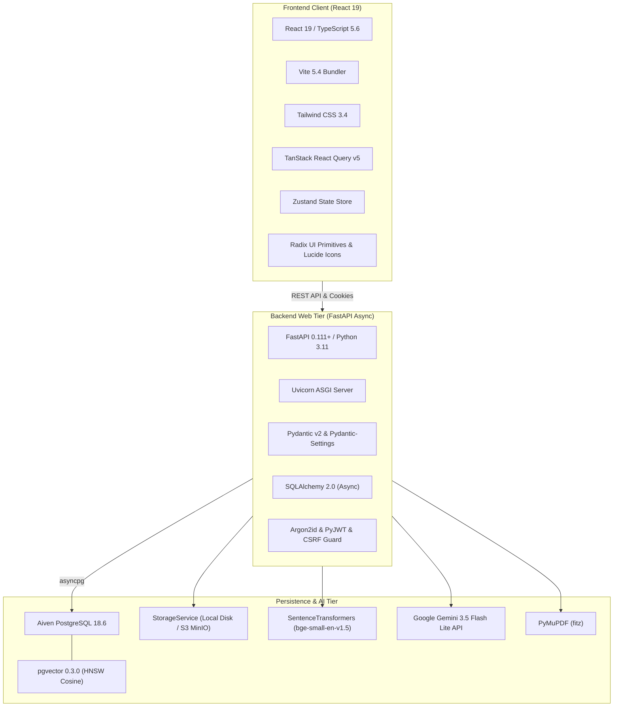
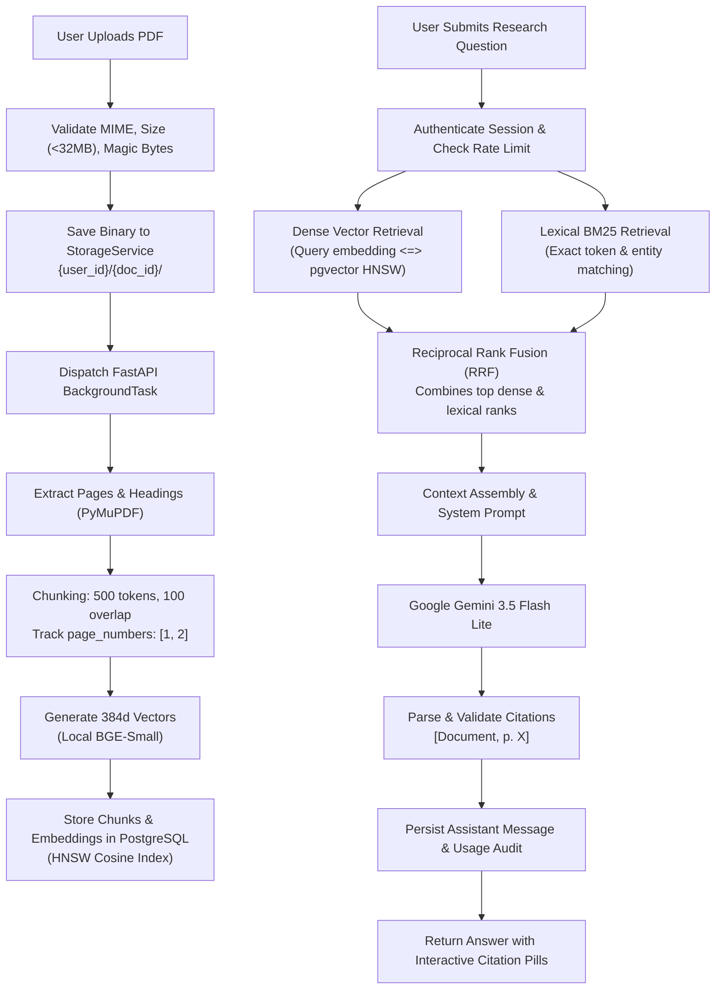
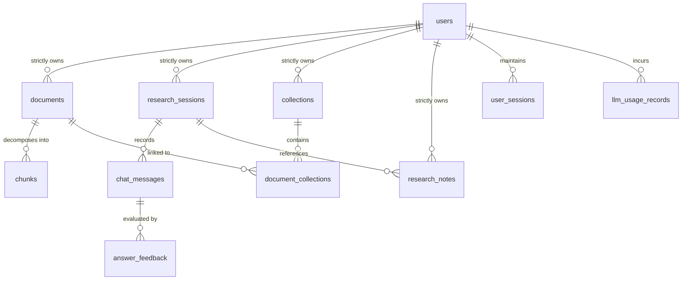

# ORION — Master Technical Documentation & Comprehensive System Architecture Report

**Document Version:** 1.0.0  
**Project:** ORION Academic Research Assistant  
**Repository:** `c:\Users\rbala\Documents\ORION`  
**Target Environment:** Private Multi-User Cloud Infrastructure (Aiven PostgreSQL 18.6 + pgvector)

---

## Executive Summary

**ORION** is a high-performance, private, multi-tenant academic research assistant engineered to solve the problem of information fragmentation, analytical fatigue, and hallucination in deep scientific literature reviews. Unlike conventional conversational chatbots that rely on general parametric memory, or simple PDF readers that perform rudimentary string searches, ORION implements a mathematically rigorous, citation-verifiable **Hybrid Retrieval-Augmented Generation (Hybrid RAG)** architecture.

Researchers upload complex academic papers (up to 32MB and 200 pages per document). ORION ingests these PDFs using structural, page-aware text extraction, divides them into semantic chunks with cross-page span preservation, computes dense 384-dimensional vector embeddings locally via `BAAI/bge-small-en-v1.5`, and persists them in an **Aiven PostgreSQL** database indexed with **pgvector HNSW** cosine distance graphs. 

When a researcher interrogates their private corpus, ORION conducts concurrent dense semantic retrieval and BM25 lexical token matching, fusing the ranked candidates via **Reciprocal Rank Fusion (RRF)**. The resulting high-relevance evidence is synthesized by **Google Gemini 3.5 Flash Lite** under strict academic prompt constraints. Every factual assertion is mapped directly back to verified source documents with 1-indexed page coordinates, allowing one-click navigation to the original source text.

Security is architected from the database tier up: all documents, chunks, vectors, sessions, and research notes are strictly isolated per authenticated user, safeguarded by **Argon2id** password hashing, **HttpOnly** session cookies, **Double-Submit CSRF tokens**, in-memory sliding window rate limiters, storage path containment guards, and PostgreSQL database-level **constraint triggers** that reject cross-tenant relationship tampering.

---

## 1. Project Overview & Problem Definition

### 1.1. Core Problem Statement
Academic researchers, legal analysts, and policy specialists are inundated with high volumes of technical literature. Navigating dozens of 50-page PDFs presents three core challenges:
1. **Information Scarcity & Needle-in-a-Haystack Retrieval**: Relevant methodologies, statistical outcomes, and empirical findings are buried across disparate chapters.
2. **LLM Hallucination Risk**: Standard generative AI systems fabricate citations, misattribute findings, or merge findings from unrelated domains.
3. **Data Privacy & Tenant Contamination**: Uploading sensitive, unpublished pre-prints or proprietary research to public multi-tenant AI tools risks data leakage and cross-user visibility.

### 1.2. The ORION Solution
ORION addresses these challenges by providing:
- **Private, Tenant-Isolated Research Spaces**: Each researcher operates within an air-gapped data boundary. Documents, embeddings, retrieval indexes, and chat sessions are scoped strictly to the authenticated user.
- **Hybrid Retrieval (Dense + Lexical)**: Overcomes dense embedding blind spots (e.g. specific acronyms, chemical formulas, numerical constants) by marrying dense vector search with BM25 lexical search via Reciprocal Rank Fusion.
- **Auditable Page-Level Provenance**: Every generated claim is linked to an exact page number `[Paper Title, p. X]`. Clicking a citation opens a dedicated PDF viewer directly to the verified page.
- **Defense-in-Depth Security**: Eliminates client-side credential storage, protects state-changing endpoints with CSRF validation, throttles abuse via sliding window rate limiting, and enforces tenant isolation at the PostgreSQL constraint level.

---

## 2. Verified Technology Stack Architecture

ORION’s technology stack is strictly partitioned into modular tiers:

### Detailed Component Specifications

| Layer | Technology | Primary Role | Implementation Location |
| :--- | :--- | :--- | :--- |
| **Frontend** | React 19 + TypeScript | UI presentation, reactive state, accessibility | `frontend/src/` |
| **Styling** | TailwindCSS + Radix UI | Responsive layout, dark/light themes, modal primitives | `frontend/tailwind.config.js` |
| **State** | TanStack Query + Zustand | Server data synchronization, client layout stores | `frontend/src/context/`, `frontend/src/store/` |
| **Backend** | FastAPI + Python 3.11 | Async REST API, OpenAPI docs, dependency injection | `backend/app/main.py` |
| **Database** | Aiven PostgreSQL 18.6 | Relational storage, tenant constraints, audit records | Cloud Aiven `defaultdb` |
| **Vector DB** | pgvector 0.3.0 | Cosine distance HNSW indexing (`m=16`, `ef_construction=64`) | `backend/alembic/versions/` |
| **ORM** | SQLAlchemy 2.0 (Async) | High-performance async database queries via `asyncpg` | `backend/app/db/` |
| **Password** | Argon2id (`argon2-cffi`) | OWASP-compliant password hashing (64MiB, 3 iter, 4 thr) | `backend/app/security/password.py` |
| **Session** | Cryptographic Tokens | HttpOnly `orion_session` cookie + DB session tracking | `backend/app/security/auth.py` |
| **CSRF** | Double-Submit Pattern | Readable `orion_csrf` cookie + `X-CSRF-Token` header | `backend/app/security/auth.py` |
| **Extraction**| PyMuPDF (`fitz`) | 1-indexed page text, font size hierarchy, headings | `backend/app/services/ingestion/extractor.py` |
| **Chunking** | `PageAwareChunker` | 500-token chunks with 100-token overlap & page arrays | `backend/app/services/ingestion/chunker.py` |
| **Embeddings**| `BAAI/bge-small-en-v1.5` | 384-dimensional dense semantic vectors (SentenceTransformers)| `backend/app/services/rag/embeddings.py` |
| **Lexical** | BM25 Ranker | Exact keyword, acronym, and numeric entity retrieval | `backend/app/services/retrieval/lexical.py` |
| **Fusion** | Reciprocal Rank Fusion | Rank combination (`score = sum(1 / (60 + rank))`) | `backend/app/services/retrieval/service.py` |
| **LLM** | Gemini 3.5 Flash Lite | Academic synthesis, evidence verification, token tracking | `backend/app/services/rag/gemini.py` |

---

## 3. End-to-End Hybrid RAG Pipeline Lifecycle

The life of a document and query within ORION follows a deterministic, verifiable sequence:

### 3.1. Ingestion Phase
1. **Validation**: Checks file size (max 32 MB), page limits (max 200 pages), MIME types (`application/pdf`), and binary magic bytes (`%PDF-`).
2. **Storage**: Binary written to disk or S3 bucket under `{user_id}/{document_id}/{filename}` with path traversal safeguards.
3. **Extraction**: PyMuPDF processes the document, outputting structured page objects containing text and detected section headings while maintaining 1-indexed page offsets.
4. **Semantic Chunking**: Text is split into 500-token windows with a 100-token sliding overlap. If a chunk spans across page boundaries, all contributing pages are captured in `chunks.page_numbers` (e.g. `[4, 5]`).
5. **Vectorization**: Batches of chunks are encoded locally using `BAAI/bge-small-en-v1.5`, producing normalized 384-dimensional floating point vectors.
6. **Persistence**: Chunks and vectors are inserted into PostgreSQL. The `documents.status` transitions from `pending` -> `extracting` -> `chunking` -> `embedding` -> `completed`.

### 3.2. Retrieval & Generation Phase
1. **Query Processing**: The incoming question is vectorized by the local embedder and tokenized for lexical search.
2. **Dense Vector Search**: Evaluates cosine distance against the user’s private chunks using the pgvector `<=>` operator over the HNSW index.
3. **Lexical BM25 Search**: Evaluates exact term frequencies, boosting chunks containing exact matches for acronyms, formulas, or author names.
4. **Reciprocal Rank Fusion (RRF)**: Combines rankings from both retrievers using standard reciprocal scoring:
   $$\text{RRF Score}(d) = \sum_{m \in \{\text{dense}, \text{lexical}\}} \frac{1}{60 + \text{rank}_m(d)}$$
5. **Synthesis with Gemini**: The top-5 fused chunks are structured into an academic prompt template instructing Gemini to synthesize evidence, acknowledge contradictory findings, and strictly format citations as `[Document Title, p. X]`.
6. **Attribution Engine**: The raw LLM response is parsed. Every citation tag is checked against the retrieved chunks to verify that the cited page and document match the supplied context. Valid citations become interactive pills in the React UI.

---

## 4. Multi-Tenant Security & Isolation Model

ORION provides complete data isolation across multiple researchers:

### 4.1. Application-Tier Filtering
Every database query in the ORION API applies explicit owner constraints:
- `SELECT ... FROM documents WHERE documents.owner_id = current_user.id`
- `SELECT ... FROM chunks JOIN documents ON chunks.document_id = documents.id WHERE documents.owner_id = current_user.id`
- Attempting to access, modify, or delete a document, session, note, or message belonging to another user raises an immediate HTTP 404 or 403 response.

### 4.2. Database-Level Constraint Triggers
To protect against bugs in application queries, Alembic migration `0002_research_domain` installs PostgreSQL constraint triggers:
- **`trg_check_document_collection_owner`**: Prevents linking User A’s document to User B’s collection in `document_collections`.
- **`trg_check_research_note_owner`**: Prevents attaching a research note to another user's session or document.
- **`trg_check_llm_usage_owner`**: Guarantees that usage tracking records linked to a session match the session owner's `user_id`.

### 4.3. Storage Containment & Path Traversal Guards
The `LocalStorageBackend` validates all file paths using `os.path.commonpath([base_directory, target_path]) == base_directory`. Any attempt to supply directory traversal sequences (`../../etc/passwd`) is aborted with a `SecurityException`.

---

## 5. Database Schema & Data Integrity

The production database is hosted on **Aiven PostgreSQL 18.6** with the **pgvector** extension active:
- **Total Managed Tables**: 12 tables + `alembic_version`.
- **Vector Column**: `chunks.embedding vector(384)`.
- **Index**: `idx_chunks_embedding_hnsw` using `vector_cosine_ops` (`m=16`, `ef_construction=64`).
- **Cascade Policies**:
  - `users.id` cascade-deletes all owned `documents`, `collections`, `research_sessions`, `research_notes`, and `user_sessions`.
  - `users.id` applies `ON DELETE SET NULL` to `llm_usage_records` to preserve financial audit trails while clearing user PII.
  - `documents.id` cascade-deletes all associated `chunks` (clearing vector memory instantly) and `document_collections` links.

---

## 6. Verification & Quality Assurance Evidence

The stability and security of the current codebase have been proven through direct execution of backend and frontend automated test suites:

### 6.1. Backend Test Suite Execution
- **Command**: `pytest backend/tests/test_auth_backend.py backend/tests/test_csrf_document_upload.py backend/tests/test_multi_user_security_hardening.py`
  - **Outcome**: **31 passed** in 23.28s.
  - **Verifications**: Argon2id hashing, session token cookies, CSRF header validation, admin quota authorization, cross-user message feedback isolation.
- **Command**: `pytest backend/tests/test_storage_abstraction.py backend/tests/test_two_user_storage_isolation.py`
  - **Outcome**: **5 passed** in 30.69s.
  - **Verifications**: Physical storage separation, cross-user document access rejection, path traversal protection.

### 6.2. Frontend Test Suite Execution
- **Command**: `npm test` (`vitest run`)
  - **Outcome**: **89 passed** across 12 test suites in 29.82s.
  - **Verifications**: Authentication modals, document upload modal progress, sidebar clean account profile (dev indicators removed), PDF viewer citation jumps, research interface markdown rendering.

### 6.3. Production Build Validation
- **Command**: `npm run build` (`tsc -b && vite build`)
  - **Outcome**: **Completed with 0 errors** in 32.13s.
  - **Artifacts**: Minified production assets generated in `frontend/dist/`.

---

## 7. Operational Readiness & Deployment Architecture

ORION is fully containerized and pre-configured for containerized cloud deployment:
- **Backend Container**: Multi-stage `backend/Dockerfile` using Python 3.11-slim, pre-caching the `BAAI/bge-small-en-v1.5` HuggingFace model during image build to eliminate cold-start download delays.
- **Frontend Container**: Multi-stage `frontend/Dockerfile` compiling TypeScript via Vite and serving production static assets via Alpine Nginx.
- **Health Probes**:
  - Liveness: `GET /api/v1/health/live` returns HTTP 200 if the process is responsive.
  - Readiness: `GET /api/v1/health/ready` verifies live Aiven PostgreSQL connectivity and storage volume accessibility.
- **Status**: The platform is **Development-Ready**, **Functionally Tested**, **Deployment-Prepared**, and validated for **Initial Multi-User Pilot Deployments**.

---

## 8. Master Documentation Cross-Reference Index

For deeper technical analyses, consult the dedicated companion reports in `docs/project-overview/`:

1. [**ORION_TECH_STACK.md**](file:///c:/Users/rbala/Documents/ORION/docs/project-overview/ORION_TECH_STACK.md): Full breakdown of every library, framework, runtime version, and file location.
2. [**ORION_SYSTEM_ARCHITECTURE.md**](file:///c:/Users/rbala/Documents/ORION/docs/project-overview/ORION_SYSTEM_ARCHITECTURE.md): Architectural flowcharts, sequence diagrams, and component responsibility matrix.
3. [**ORION_FEATURE_MATRIX.md**](file:///c:/Users/rbala/Documents/ORION/docs/project-overview/ORION_FEATURE_MATRIX.md): Exhaustive capability inventory with test status, endpoints, and database tables.
4. [**ORION_SECURITY_AND_DATABASE.md**](file:///c:/Users/rbala/Documents/ORION/docs/project-overview/ORION_SECURITY_AND_DATABASE.md): Deep dive on Argon2id, CSRF double-submit, PostgreSQL triggers, and schema ERD.
5. [**ORION_ROADMAP.md**](file:///c:/Users/rbala/Documents/ORION/docs/project-overview/ORION_ROADMAP.md): Detailed inventory of known technical constraints and prioritized multi-phase roadmap.

