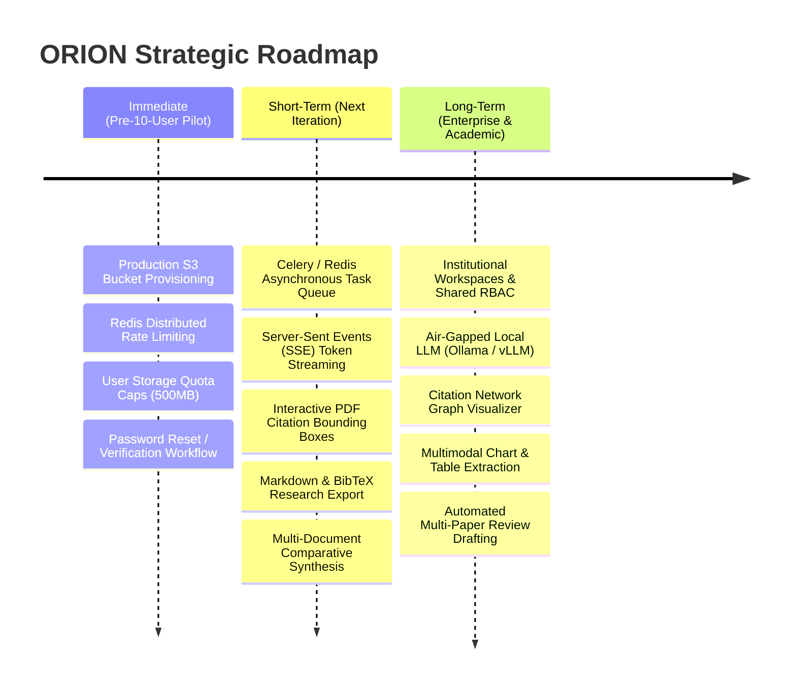

# ORION — Technical Limitations & Strategic Roadmap

This document outlines the current technical debt, known architectural limitations, and a prioritized engineering roadmap for the ORION academic research assistant platform.

---

## 1. Current Technical Limitations & Architectural Constraints

An honest engineering audit identifies the following constraints in the current implementation:

### 1.1. In-Process Ingestion Task Execution
- **Current State**: PDF text extraction, chunking, and dense embedding generation execute asynchronously via FastAPI’s `BackgroundTasks` within the web server process.
- **Limitation**: While efficient for single-node deployments and the 10-user pilot, CPU-intensive embedding generation (`BAAI/bge-small-en-v1.5`) competes with web request handling. A sudden influx of large PDF batch uploads could cause latency spikes on HTTP request threads.
- **Architectural Solution**: Extract the background ingestion pipeline into an independent worker service running Celery or RQ backed by a Redis/RabbitMQ task broker.

### 1.2. In-Memory Rate Limiting
- **Current State**: The `AuthRateLimiter` maintains sliding window request logs in Python memory (`dict` of timestamp deques).
- **Limitation**: In a multi-replica container deployment behind a load balancer (e.g. Kubernetes or AWS ECS with multiple tasks), rate limits are evaluated per-instance rather than globally.
- **Architectural Solution**: Migrate rate limiting state to a shared Redis cluster utilizing the `sliding_window` or token-bucket Lua script.

### 1.3. Absence of OCR for Non-Textual Scanned PDFs
- **Current State**: Document extraction relies on `PyMuPDF` (`fitz`), which extracts text streams, character encodings, and font metrics.
- **Limitation**: Scanned historical manuscripts, non-digitized PDFs, or image-only documents without embedded OCR text layers will yield zero extracted text and fail ingestion.
- **Architectural Solution**: Integrate a fallback Tesseract OCR or docTR pipeline triggered when PyMuPDF detects image-only pages.

### 1.4. Non-Streaming Response Delivery
- **Current State**: The `/api/v1/research/sessions/{id}/ask` endpoint blocks until Gemini completes full response generation, parses citations, and commits usage records to PostgreSQL, returning a unified JSON payload.
- **Limitation**: Responses to complex research queries taking 4–8 seconds display a loading spinner rather than immediate token-by-token streaming.
- **Architectural Solution**: Implement Server-Sent Events (SSE) or WebSocket streaming to stream generative tokens incrementally to the React frontend while computing citation attribution asynchronously.

### 1.5. Local Filesystem Default for Binary Storage
- **Current State**: While the `StorageService` abstraction cleanly supports `S3StorageBackend`, the default development deployment targets local disk directory structures.
- **Limitation**: Scaling horizontally across ephemeral containers requires active S3/MinIO bucket provisioning and persistent volume attachments.

---

## 2. Prioritized Engineering Roadmap

---

## 3. Detailed Phase Breakdown

### Phase 1: Immediate Priorities (Pre-10-User Pilot Hardening)

1. **Distributed Rate Limiting & Session Store**:
   - Integrate Redis as a centralized backing store for `AuthRateLimiter` and active session tokens.
   - Ensure consistent throttling regardless of horizontal instance scaling.
2. **User Storage Quotas**:
   - Implement storage size limits per tenant (e.g. 500 MB max cumulative PDF storage per researcher).
   - Display a visual storage capacity meter on the frontend Document List.
3. **Automated Password Reset**:
   - Provide secure, time-limited cryptographic password reset tokens delivered via email or administrative console.
4. **Automated S3 Provisioning**:
   - Ensure the S3 storage backend is default in staging/production environments with automated bucket lifecycle policies.

---

### Phase 2: Short-Term Enhancements (Next Development Iteration)

1. **Decoupled Asynchronous Task Workers**:
   - Move `process_document_pipeline` to dedicated Celery worker containers.
   - Free API instances to handle pure HTTP traffic with zero CPU contention.
2. **Real-Time Token Streaming (SSE)**:
   - Stream Gemini response tokens as they are generated using FastAPI `StreamingResponse` and EventSource on the React frontend.
   - Deliver sub-second perceived response latency.
3. **Interactive Citation Bounding Box Overlays**:
   - Leverage PyMuPDF word-level quad bounding boxes to highlight specific cited sentences directly on the rendered PDF canvas in `PDFViewer.tsx`.
4. **Research Export Engine**:
   - Allow researchers to export chat sessions, cited syntheses, and research notes into formatted PDF reports, Markdown documents, and BibTeX bibliographies.
5. **Cross-Document Comparative Synthesis**:
   - Enable researchers to select multiple specific documents or entire collections as explicit context scopes for comparative analysis questions (e.g. *"Compare methodologies across Document A and Document B"*).

---

### Phase 3: Long-Term Enterprise & Academic Capabilities

1. **Institutional Workspaces & Collaborative Research**:
   - Introduce multi-tenant organizational hierarchies where principal investigators can share curated document collections with research teams while preserving granular read/write permissions.
2. **On-Premise / Air-Gapped Local LLM Inference**:
   - Provide pluggable local model backends (vLLM, Ollama, HuggingFace TGI) running open-weights models (e.g. Llama 3, Mistral NeMo) for defense, medical, or proprietary commercial research.
3. **Citation Network & Knowledge Graph Visualizer**:
   - Parse DOI references and bibliographic sections across uploaded papers to generate interactive 3D citation network graphs showing conceptual overlaps and seminal literature hubs.
4. **Multimodal Table & Chart Understanding**:
   - Ingest academic tables and figures using vision-language models (e.g. Gemini Vision or ColPali) to support technical queries against complex data plots and statistical tables.
5. **Automated Literature Review Generator**:
   - Multi-agent workflow executing recursive research queries, synthesizing common themes, contrasting opposing academic viewpoints, and generating multi-page literature review drafts.

