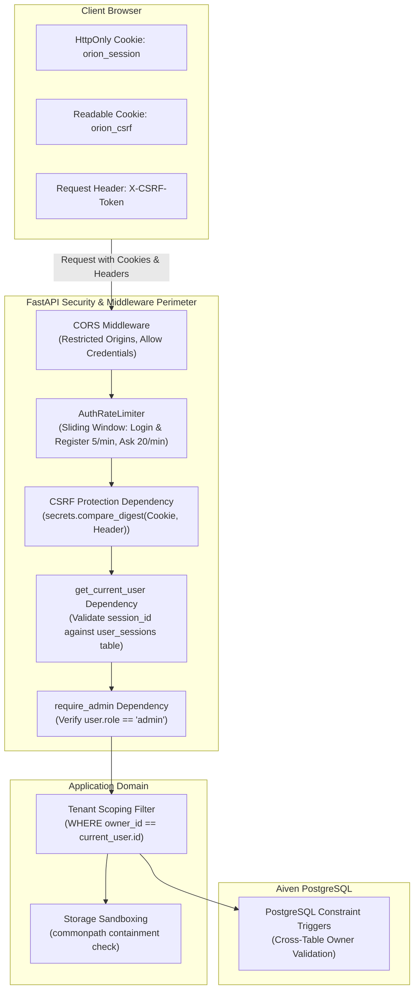
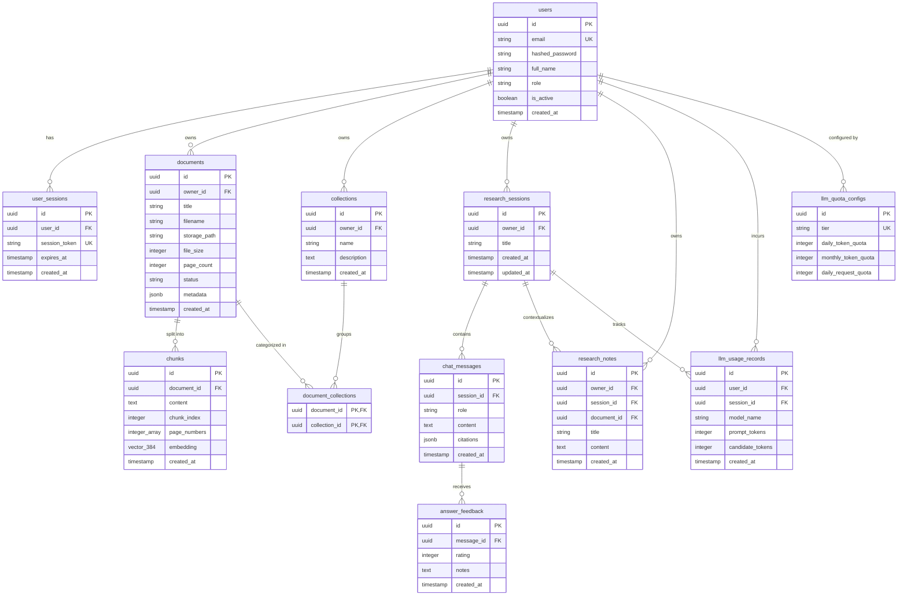

# ORION — Security Architecture & Database Specification

This document details the authentication protocols, multi-tenant data isolation, security hardening, and database schema governing the ORION platform.

---

## 1. Security & Authentication Architecture

ORION implements a defense-in-depth security model designed to satisfy enterprise data privacy requirements for academic research literature and private institutional repositories.



### 1.1. Password Hashing (Argon2id)
All user passwords are encrypted using **Argon2id**—the winner of the Password Hashing Competition (PHC) and OWASP’s recommended algorithm:
- **Algorithm**: `argon2id` via `argon2-cffi`
- **Memory Cost (`m`)**: 65,536 KiB (64 MiB)
- **Time Cost (`t`)**: 3 iterations
- **Parallelism (`p`)**: 4 threads
- **Salt Generation**: Cryptographically secure 16-byte random salt per user record.
- **Timing Attack Resistance**: Password verification executes in constant time to prevent side-channel timing analysis.

### 1.2. Dual-Token Cookie Session Architecture
ORION avoids storing authorization tokens in `localStorage` or `sessionStorage` to eliminate cross-site scripting (XSS) token theft:
1. **`orion_session` (Authentication Token)**:
   - Generated as a 32-byte cryptographically secure random token (`secrets.token_urlsafe(32)`).
   - Flagged with `HttpOnly=True` (inaccessible to JavaScript).
   - Flagged with `SameSite=Lax` (protects against cross-origin ambient requests).
   - Flagged with `Secure=True` in production (enforced when `ENVIRONMENT=production`).
   - Stored in the `user_sessions` database table with foreign key to `users.id` and an explicit `expires_at` timestamp.
2. **`orion_csrf` (CSRF Double-Submit Token)**:
   - Set as a readable cookie (`HttpOnly=False`, `SameSite=Lax`).
   - The frontend reads this value and echoes it on all state-changing requests (`POST`, `PUT`, `DELETE`) via the `X-CSRF-Token` header.
   - The backend validates the header against the cookie using constant-time evaluation (`secrets.compare_digest(header_csrf, cookie_csrf)`).

### 1.3. Rate Limiting Protection
Implemented in [`backend/app/security/rate_limiter.py`](file:///c:/Users/rbala/Documents/ORION/backend/app/security/rate_limiter.py) using an in-memory sliding window algorithm:
- **Authentication Endpoints** (`/api/v1/auth/login`, `/api/v1/auth/register`):
  - 5 attempts per IP per minute.
  - Prevents credential stuffing, dictionary attacks, and user enumeration.
- **Research Generation Endpoint** (`/api/v1/research/sessions/{id}/ask`):
  - 20 queries per user per minute.
  - Protects upstream Gemini API quota limits and prevents compute denial of service.

### 1.4. Storage Path Traversal Prevention
Implemented in [`backend/app/services/storage/local.py`](file:///c:/Users/rbala/Documents/ORION/backend/app/services/storage/local.py):
- Files are saved strictly inside `{STORAGE_LOCAL_ROOT}/{user_id}/{document_id}/{filename}`.
- Every read, write, and delete operation resolves the absolute path and performs:
  ```python
  base_dir = os.path.abspath(self.root_dir)
  target_path = os.path.abspath(os.path.join(base_dir, user_id, document_id, filename))
  if os.path.commonpath([base_dir, target_path]) != base_dir:
      raise SecurityException("Access denied: Path traversal detected")
  ```
- This prevents `../` path injection attacks from accessing system files or other tenant directories.

---

## 2. Database Schema & Data Models

ORION’s relational schema is managed via **Alembic** and hosted on **Aiven PostgreSQL 18.6** with the **pgvector 0.3.0** extension.

### 2.1. Current Migration Status
- Current Alembic Revision: `0002_research_domain (head)`
- Total Managed Tables: 12 domain and operational tables (+ `alembic_version`).

### 2.2. Entity-Relationship Diagram



---

## 3. Database-Level Multi-Tenant Isolation

Application-level filtering (`WHERE owner_id = current_user.id`) is reinforced with **PostgreSQL database-level constraint triggers**. This prevents data tampering even in the event of an application logic bug or direct database execution.

### 3.1. PostgreSQL Constraint Triggers (Alembic Revision 0002)

1. **`trg_check_document_collection_owner`**:
   - **Enforcement**: Verifies that when a document is linked to a collection in `document_collections`, both the document and the collection have the identical `owner_id`.
   - **Trigger Function**:
     ```sql
     CREATE OR REPLACE FUNCTION check_document_collection_owner()
     RETURNS TRIGGER AS $$
     DECLARE
         doc_owner UUID;
         col_owner UUID;
     BEGIN
         SELECT owner_id INTO doc_owner FROM documents WHERE id = NEW.document_id;
         SELECT owner_id INTO col_owner FROM collections WHERE id = NEW.collection_id;
         IF doc_owner <> col_owner THEN
             RAISE EXCEPTION 'Tenant isolation violation: Document owner % does not match Collection owner %', doc_owner, col_owner;
         END IF;
         RETURN NEW;
     END;
     $$ LANGUAGE plpgsql;
     ```

2. **`trg_check_research_note_owner`**:
   - **Enforcement**: Verifies that when a research note is attached to a session or a document, the note's `owner_id` strictly matches the session's `owner_id` and the document's `owner_id`.

3. **`trg_check_llm_usage_owner`**:
   - **Enforcement**: Verifies that an LLM usage audit record linked to a session shares the same `user_id` as the session's `owner_id`.

---

## 4. Vector Storage & HNSW Indexing Specification

The `chunks` table stores dense semantic representations of extracted PDF passages:
- **Vector Column**: `embedding vector(384)`
- **Distance Metric**: Cosine Distance (`vector_cosine_ops`)
- **Index Type**: Hierarchical Navigable Small World (**HNSW**)
- **Index Definition**:
  ```sql
  CREATE INDEX idx_chunks_embedding_hnsw 
  ON chunks USING hnsw (embedding vector_cosine_ops)
  WITH (m = 16, ef_construction = 64);
  ```
- **Index Parameters**:
  - `m = 16`: Number of bidirectional links established per vector node during graph construction.
  - `ef_construction = 64`: Size of the dynamic candidate list evaluated during index construction.
  - `ef_search = 64`: Dynamic candidate list evaluated at query time, guaranteeing sub-50ms retrieval latencies across large chunk populations.

---

## 5. Cascading Deletion & Audit Integrity

- **User Deletion**:
  - `users.id` -> `documents.owner_id` (`ON DELETE CASCADE`)
  - `users.id` -> `collections.owner_id` (`ON DELETE CASCADE`)
  - `users.id` -> `research_sessions.owner_id` (`ON DELETE CASCADE`)
  - `users.id` -> `user_sessions.user_id` (`ON DELETE CASCADE`)
  - `users.id` -> `llm_usage_records.user_id` (`ON DELETE SET NULL`) — preserves historical usage audit data for financial reconciliation without retaining deleted user credentials.
- **Document Deletion**:
  - `documents.id` -> `chunks.document_id` (`ON DELETE CASCADE`) — automatically clears all dense vectors from pgvector when a paper is removed.
  - `documents.id` -> `document_collections.document_id` (`ON DELETE CASCADE`)
  - `documents.id` -> `research_notes.document_id` (`ON DELETE SET NULL`) — keeps research notes intact while unlinking the deleted PDF.

