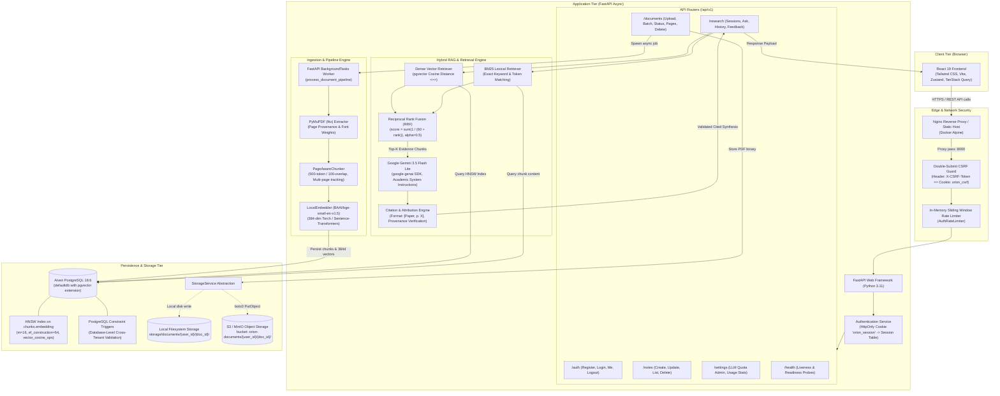
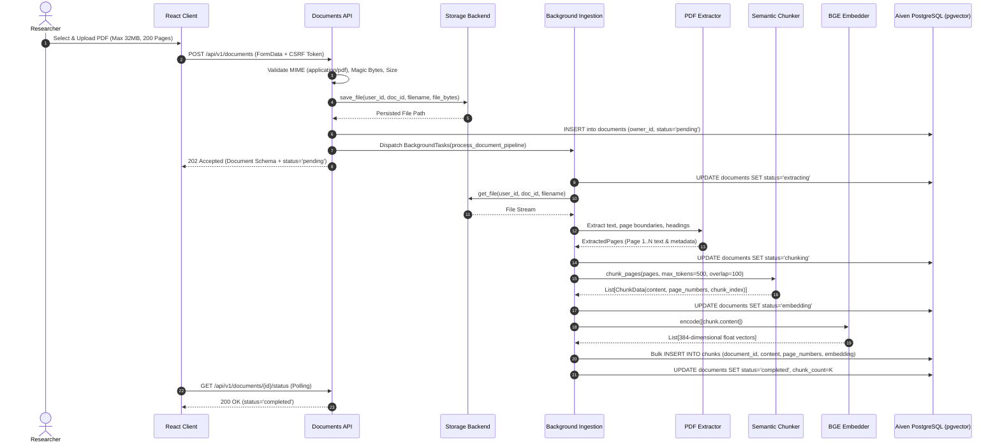
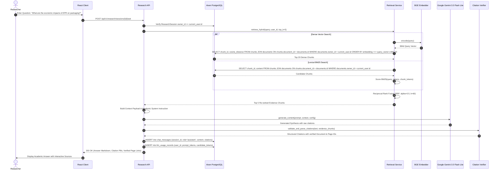

# ORION — System Architecture & Component Specification

This document details the architectural topology, communication pipelines, and component responsibilities of the ORION academic research assistant platform.

---

## 1. High-Level System Architecture Diagram

---

## 2. Component Responsibility Matrix

| Subsystem | Source Component | File Location | Key Responsibilities |
| :--- | :--- | :--- | :--- |
| **Frontend UI** | `App.tsx` | [`frontend/src/App.tsx`](file:///c:/Users/rbala/Documents/ORION/frontend/src/App.tsx) | Application shell, routing configuration, global modal providers, toast container (`Sonner`). |
| **Auth Context** | `AuthContext.tsx` | [`frontend/src/context/AuthContext.tsx`](file:///c:/Users/rbala/Documents/ORION/frontend/src/context/AuthContext.tsx) | User identity state, session bootstrap, login/logout synchronization, CSRF token persistence. |
| **API Client** | `api.ts` | [`frontend/src/services/api.ts`](file:///c:/Users/rbala/Documents/ORION/frontend/src/services/api.ts) | Fetch wrapper attaching `credentials: 'include'` and `X-CSRF-Token` headers; handles standard error envelopes. |
| **Document Modal**| `UploadModal.tsx` | [`frontend/src/components/UploadModal.tsx`](file:///c:/Users/rbala/Documents/ORION/frontend/src/components/UploadModal.tsx) | Drag-and-drop PDF upload interface, file validation, progress state, and batch submission. |
| **Research Interface**| `ResearchInterface.tsx`| [`frontend/src/components/ResearchInterface.tsx`](file:///c:/Users/rbala/Documents/ORION/frontend/src/components/ResearchInterface.tsx) | Interactive chat interface, markdown stream rendering, interactive citation pills, and PDF page viewer drawer. |
| **PDF Inspector** | `PDFViewer.tsx` | [`frontend/src/components/PDFViewer.tsx`](file:///c:/Users/rbala/Documents/ORION/frontend/src/components/PDFViewer.tsx) | Render extracted PDF page images, zoom controls, bounding boxes, and citation jump navigation. |
| **Configuration** | `config.py` | [`backend/app/core/config.py`](file:///c:/Users/rbala/Documents/ORION/backend/app/core/config.py) | Centralized `pydantic-settings` class loading database URLs, CORS origins, cookie security flags, and model keys. |
| **Database Engine**| `session.py` | [`backend/app/db/session.py`](file:///c:/Users/rbala/Documents/ORION/backend/app/db/session.py) | Async SQLAlchemy engine creation, connection pooling, and tenant session lifecycle injection (`get_db`). |
| **Security Service**| `auth.py` / `service.py` | [`backend/app/security/auth.py`](file:///c:/Users/rbala/Documents/ORION/backend/app/security/auth.py) | Password verification (Argon2id), session cookie issuance (`orion_session`), CSRF validation (`compare_digest`). |
| **Rate Limiter** | `rate_limiter.py` | [`backend/app/security/rate_limiter.py`](file:///c:/Users/rbala/Documents/ORION/backend/app/security/rate_limiter.py) | Sliding window memory rate limiter preventing brute-force logins and LLM query exhaustion. |
| **Storage Gateway**| `StorageService` | [`backend/app/services/storage/`](file:///c:/Users/rbala/Documents/ORION/backend/app/services/storage) | Factory selecting `LocalStorageBackend` or `S3StorageBackend`; enforces tenant path containment (`commonpath`). |
| **Document Ingestion**| `service.py` | [`backend/app/services/ingestion/service.py`](file:///c:/Users/rbala/Documents/ORION/backend/app/services/ingestion/service.py) | Background ingestion orchestrator: state tracking (`extracting`, `chunking`, `embedding`, `completed`, `failed`). |
| **Text Extraction**| `extractor.py` | [`backend/app/services/ingestion/extractor.py`](file:///c:/Users/rbala/Documents/ORION/backend/app/services/ingestion/extractor.py) | PyMuPDF extraction preserving 1-indexed page boundaries, font size hierarchies, and heading structures. |
| **Semantic Chunker**| `chunker.py` | [`backend/app/services/ingestion/chunker.py`](file:///c:/Users/rbala/Documents/ORION/backend/app/services/ingestion/chunker.py) | Sliding window chunking (500 tokens, 100 token overlap) with cross-page span preservation (`page_numbers`). |
| **Embedding Engine**| `embeddings.py` | [`backend/app/services/rag/embeddings.py`](file:///c:/Users/rbala/Documents/ORION/backend/app/services/rag/embeddings.py) | SentenceTransformers worker generating 384-dimensional normalized vectors via `BAAI/bge-small-en-v1.5`. |
| **Hybrid Retrieval**| `service.py` | [`backend/app/services/retrieval/service.py`](file:///c:/Users/rbala/Documents/ORION/backend/app/services/retrieval/service.py) | Coordinates dense vector search and BM25 lexical search, combining ranks via Reciprocal Rank Fusion (RRF). |
| **Dense Search** | `vector.py` | [`backend/app/services/retrieval/vector.py`](file:///c:/Users/rbala/Documents/ORION/backend/app/services/retrieval/vector.py) | PostgreSQL pgvector cosine similarity search (`<=>`) utilizing HNSW indexing with tenant-filtered scoping. |
| **Lexical Search**| `lexical.py` | [`backend/app/services/retrieval/lexical.py`](file:///c:/Users/rbala/Documents/ORION/backend/app/services/retrieval/lexical.py) | BM25 ranker scoring exact matches for chemical formulas, author names, acronyms, and numeric statistical data. |
| **Generative LLM** | `gemini.py` | [`backend/app/services/rag/gemini.py`](file:///c:/Users/rbala/Documents/ORION/backend/app/services/rag/gemini.py) | Prompts Google Gemini with retrieved chunks, citation requirements, and token quotas; logs usage to `llm_usage_records`. |
| **Citation Verifier**| `citations.py` | [`backend/app/services/rag/citations.py`](file:///c:/Users/rbala/Documents/ORION/backend/app/services/rag/citations.py) | Parses LLM output, extracts `[Document Title, p. X]` markers, validates against context chunks, and formats UI citation nodes. |

---

## 3. End-to-End Data Flow Sequence

### 3.1. Document Ingestion Pipeline Flow

---

### 3.2. Hybrid RAG Query & Answer Synthesis Flow

