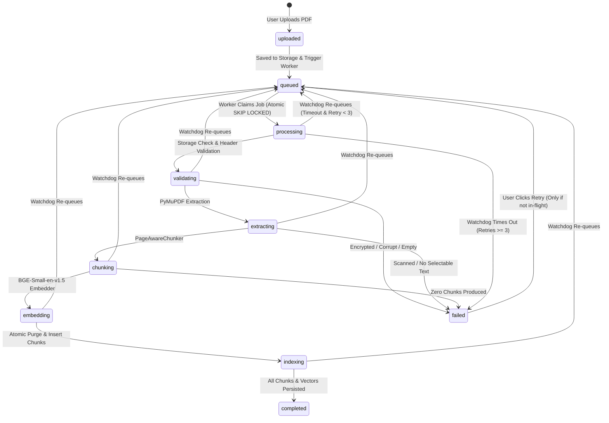

# ORION — Phase 6A: Ingestion Reliability & PDF Edge-Case Hardening Report

**Document Version:** 1.0.0  
**Status:** Completed and Verified  
**Milestone:** Phase 6A — Ingestion Reliability, PDF Edge-Case Hardening, and Watchdog Recovery  
**Target Architecture:** Multi-Tenant Private RAG Assistant (FastAPI, PyMuPDF, SQLAlchemy Async, Aiven PostgreSQL)

---

## 1. Executive Summary

Phase 6A resolves the critical ingestion vulnerabilities identified in the Phase 6 completion audit:
1. **Elimination of Duplicate Ingestion Dispatch**: Removed the duplicate `BackgroundTasks` dispatch that was racing with `DurableIngestionWorker`, establishing `DurableIngestionWorker` as the sole authoritative, atomic execution engine backed by `FOR UPDATE SKIP LOCKED`.
2. **Proper Scanned & Empty PDF Rejection**: Replaced the silent zero-chunk ingestion pass-through with explicit failure handling. Scanned/image-only PDFs are now classified as `failed` with stable error code `ERR_PDF_SCANNED_NO_TEXT` and user-friendly guidance.
3. **Password-Protected & Encrypted PDF Detection**: Integrated PyMuPDF's encryption APIs (`doc.is_encrypted`, `doc.needs_pass`) to reject locked files immediately with `ERR_PDF_ENCRYPTED` before attempting text extraction.
4. **Durable Stuck-Ingestion Watchdog**: Implemented a non-intrusive periodic watchdog running within `DurableIngestionWorker.run()` that detects jobs stuck in active ingestion states beyond a configurable timeout (default 180s), purging partial chunks and safely re-queuing up to 3 retries before marking as permanently failed (`ERR_INGESTION_TIMEOUT`).
5. **Frontend Resilient Error Presentation**: Enhanced the document library, detail modal, and upload modal to surface human-readable failure messages matching ORION's cream/amber aesthetic without exposing internal stack traces or database internals.
6. **Zero-Regression Verification**: All 10 mandated requirements verified via a new automated test suite (`test_ingestion_reliability.py`), 42 existing backend tests passed, 89 frontend tests passed across 12 suites, and production build succeeded with 0 errors.

---

## 2. Root Cause Analysis

| Issue Identified | Root Cause in Codebase | Consequence Prior to Phase 6A |
| :--- | :--- | :--- |
| **Dual Dispatch Race Condition** | In `documents.py` lines 145–146, 310–311, and 616–617, code called **both** `get_ingestion_worker().trigger()` and `background_tasks.add_task(run_background_ingestion, doc.id)`. | In single uploads, batch uploads, and retries, two separate asynchronous tasks concurrently executed `pipeline.process_document` on the same document record, causing race conditions in chunk insertion and state updates. |
| **Silent Scanned PDF Success** | In `pipeline.py` line 64, condition `if not text_chunks and not extraction.is_scanned_or_empty:` skipped raising when `is_scanned_or_empty` was `True`. | Image-only scanned PDFs generated 0 chunks, 0 embeddings, and transitioned to `completed`. The researcher saw a green "Completed" status, but all Q&A searches returned 0 results. |
| **Unhandled Encrypted PDFs** | `extractor.py` did not inspect `doc.is_encrypted` or `doc.needs_pass` before attempting page indexing. | PyMuPDF threw unhandled `ValueError: document closed or encrypted` or produced empty strings, failing mid-process without actionable user feedback. |
| **Stuck Ingestion Abandonment** | `recover_interrupted_jobs` was only invoked once during server startup in `lifespan`. | If a worker crashed, cancelled, or hung while the server remained running, documents remained in `validating`, `extracting`, `chunking`, or `embedding` indefinitely. |
| **In-Flight Retry Conflict** | `POST /{document_id}/retry` reset `doc.status = "queued"` without checking if the document was already in-flight. | Users could repeatedly click "Retry" while a worker was actively embedding chunks, causing duplicate chunks and database conflicts. |

---

## 3. Files Modified

| File Path | Nature of Changes |
| :--- | :--- |
| [`backend/app/core/config.py`](file:///c:/Users/rbala/Documents/ORION/backend/app/core/config.py) | Added `INGESTION_STUCK_TIMEOUT_SECONDS: int = 180` and `INGESTION_WATCHDOG_INTERVAL_SECONDS: float = 15.0`. |
| [`backend/app/core/errors.py`](file:///c:/Users/rbala/Documents/ORION/backend/app/core/errors.py) | Extended `IngestionError` to accept optional `error_code` parameter (defaulting to stage-based fallback). |
| [`backend/app/schemas/document.py`](file:///c:/Users/rbala/Documents/ORION/backend/app/schemas/document.py) | Added optional `error_code: str | None = None` to `DocumentBase` and `DocumentStatusResponse`. |
| [`backend/app/services/ingestion/extractor.py`](file:///c:/Users/rbala/Documents/ORION/backend/app/services/ingestion/extractor.py) | Added PyMuPDF `doc.is_encrypted` and `doc.needs_pass` checks (`ERR_PDF_ENCRYPTED`). Added scanned/image-only check throwing `ERR_PDF_SCANNED_NO_TEXT`. Handled empty and corrupted PDFs with `ERR_PDF_EMPTY` and `ERR_PDF_CORRUPT`. |
| [`backend/app/services/ingestion/pipeline.py`](file:///c:/Users/rbala/Documents/ORION/backend/app/services/ingestion/pipeline.py) | Ensured empty text chunk output throws `ERR_PDF_SCANNED_NO_TEXT`. Purged partial chunks upon failure. Sanitized error messages to avoid leaking tracebacks to `processing_error`. |
| [`backend/app/services/ingestion/worker.py`](file:///c:/Users/rbala/Documents/ORION/backend/app/services/ingestion/worker.py) | Added `recover_stuck_jobs` periodic watchdog with timeout calculation, partial chunk cleanup, retry counter tracking, and permanent failure marking. Added non-retry logic for permanent validation errors (`ERR_PDF_ENCRYPTED`, `ERR_PDF_SCANNED_NO_TEXT`). Purged partial chunks on startup recovery. |
| [`backend/app/api/v1/documents.py`](file:///c:/Users/rbala/Documents/ORION/backend/app/api/v1/documents.py) | Removed `background_tasks.add_task(run_background_ingestion, ...)` from single upload, batch upload, and retry. Added in-flight guard to `retry_document_ingestion` (HTTP 409 Conflict if active). Extracted `error_code` in `get_document_status`. |
| [`frontend/src/features/documents/DocumentLibrary.tsx`](file:///c:/Users/rbala/Documents/ORION/frontend/src/features/documents/DocumentLibrary.tsx) | Rendered friendly error message under document filename for failed items with cream/amber/red styling. |
| [`frontend/src/features/documents/DocumentDetailModal.tsx`](file:///c:/Users/rbala/Documents/ORION/frontend/src/features/documents/DocumentDetailModal.tsx) | Redesigned failure details panel using `AlertTriangle` and ORION amber card design. |
| [`frontend/src/features/documents/UploadModal.tsx`](file:///c:/Users/rbala/Documents/ORION/frontend/src/features/documents/UploadModal.tsx) | Added full title tooltip on truncated error labels in upload list. |
| [`backend/tests/test_ingestion_reliability.py`](file:///c:/Users/rbala/Documents/ORION/backend/tests/test_ingestion_reliability.py) | **New test suite** with 10 comprehensive tests covering all Phase 6A requirements. |

---

## 4. Key Design Decisions

### 4.1. Single Authoritative Execution via `DurableIngestionWorker`
FastAPI `BackgroundTasks` is in-process and ephemeral; it cannot be monitored, locked, or queried across worker boundaries. The existing `DurableIngestionWorker` queries the `documents` table using `SELECT ... WHERE status = 'queued' FOR UPDATE SKIP LOCKED` (on PostgreSQL). 
- By removing `background_tasks.add_task`, exactly one worker claims the document row atomically.
- Calling `get_ingestion_worker().trigger()` simply pulses `asyncio.Event` to wake the worker loop immediately without delay.

### 4.2. Fail-Fast for Permanent PDF Incompatibility
Certain errors are inherently permanent:
- Password-protected PDFs (`ERR_PDF_ENCRYPTED`)
- Scanned / image-only PDFs (`ERR_PDF_SCANNED_NO_TEXT`)
- Corrupted file headers or bodies (`ERR_PDF_CORRUPT`)
- Zero-byte files or zero pages (`ERR_PDF_EMPTY`)
- Page limit exceeded (`ERR_PDF_PAGE_LIMIT`)

Previously, the worker retried all failures up to 3 times, causing unnecessary delay and wasting CPU/database cycles. In Phase 6A:
- Permanent errors are classified immediately via `IngestionError.error_code`.
- `DurableIngestionWorker` bypasses retry loops for permanent errors, marking the document as `failed` immediately.
- Transient errors (e.g. database deadlocks or network disconnects during embedding) continue to retry up to 3 times with exponential backoff.

### 4.3. Non-Intrusive Watchdog Architecture
The watchdog runs directly within `DurableIngestionWorker.run()` every 15 seconds (`INGESTION_WATCHDOG_INTERVAL_SECONDS`):
- It evaluates `updated_at < (now - INGESTION_STUCK_TIMEOUT_SECONDS)`.
- Because active workers update `updated_at` at each pipeline transition (`validating`, `extracting`, `chunking`, `embedding`, `indexing`), legitimately active workers are never touched.
- When a stuck job is detected, any partial chunks from the aborted run are deleted immediately via `DELETE FROM chunks WHERE document_id = doc.id` before re-queuing, preventing duplicate chunks.
- If a job has been recovered 3 times, it is permanently marked as `failed` with `ERR_INGESTION_TIMEOUT`.

### 4.4. Consistent User-Facing Error Messages
All technical stack traces and internal exceptions are redacted. The frontend displays specific, actionable messages:

| Condition | Error Code | Exact User-Facing Message |
| :--- | :--- | :--- |
| **Password Protected** | `ERR_PDF_ENCRYPTED` | `"This PDF is password-protected or encrypted. Please remove password protection before uploading."` |
| **Scanned / Image-Only** | `ERR_PDF_SCANNED_NO_TEXT` | `"This PDF appears to contain scanned images or no extractable text. OCR is not currently supported. Please upload a text-based PDF."` |
| **Corrupted File** | `ERR_PDF_CORRUPT` | `"The uploaded PDF is corrupted or has an invalid structure. Please verify that it opens correctly in a desktop reader."` |
| **Empty File** | `ERR_PDF_EMPTY` | `"Uploaded PDF byte stream is empty (0 bytes)."` |
| **Page Limit Exceeded** | `ERR_PDF_PAGE_LIMIT` | `"PDF has {count} pages, which exceeds the limit of {max}."` |
| **Timeout Failure** | `ERR_INGESTION_TIMEOUT` | `"Ingestion timed out after {timeout}s and exceeded maximum recovery attempts ({retries})."` |

---

## 5. Ingestion Status Lifecycle State Machine

---

## 6. Security Considerations

- **No Sensitive Leakage**: Encrypted PDF handling does not log passwords or encrypted metadata.
- **Traceback Redaction**: Unhandled exceptions are logged to server stderr with `logger.error(..., exc_info=True)`, but `doc.processing_error` only receives a safe, sanitized generic error.
- **Storage Safety**: Storage paths continue to enforce `os.path.commonpath` directory containment.
- **Tenant Isolation Preserved**: Multi-user permissions are checked on all document status, file, render, and retry endpoints. User B cannot view or retry User A's failed or active documents (tested in `test_10_multi_user_document_isolation_intact`).
- **Database Concurrency Safety**: Job claiming uses `FOR UPDATE SKIP LOCKED` on PostgreSQL, preventing worker contention and deadlocks.

---

## 7. Verification & Automated Test Results

### 7.1. Dedicated Phase 6A Test Suite
- **Command**: `backend/.venv/Scripts/python -m pytest backend/tests/test_ingestion_reliability.py`
- **Outcome**: **10 passed in 149.32s**

| # | Test Name | Target Requirement | Status |
| :-: | :--- | :--- | :-: |
| 1 | `test_01_upload_triggers_only_durable_worker` | Upload triggers exactly one worker; BackgroundTasks duplicate removed. | **PASSED** |
| 2 | `test_02_concurrent_workers_cannot_claim_same_document` | Atomic claiming prevents two concurrent workers from claiming same doc. | **PASSED** |
| 3 | `test_03_scanned_pdf_marked_failed_not_completed` | Scanned/image-only PDF raises `ERR_PDF_SCANNED_NO_TEXT`. | **PASSED** |
| 4 | `test_04_encrypted_pdf_rejected_with_error` | Encrypted PDF detected before extraction; raises `ERR_PDF_ENCRYPTED`. | **PASSED** |
| 5 | `test_05_corrupted_pdf_handled_safely` | Corrupted PDF raises `ERR_PDF_CORRUPT` without server crash. | **PASSED** |
| 6 | `test_06_empty_extraction_never_creates_false_success` | Extraction yielding zero chunks persists `failed` and 0 chunks. | **PASSED** |
| 7 | `test_07_stuck_job_detected_and_recovered_by_watchdog` | Stuck document past timeout is detected, partial chunks purged, re-queued. | **PASSED** |
| 8 | `test_08_active_job_within_timeout_not_recovered` | Active job with recent timestamp is untouched by watchdog. | **PASSED** |
| 9 | `test_09_retrying_ingestion_does_not_duplicate_chunks` | Pipeline retry purges old chunks; chunk count is identical, not doubled. | **PASSED** |
| 10 | `test_10_multi_user_document_isolation_intact` | User B cannot view status or retry User A's document (HTTP 403). | **PASSED** |

### 7.2. Regression Test Suite Execution
- **Command**: `backend/.venv/Scripts/python -m pytest backend/tests/test_auth_backend.py backend/tests/test_csrf_document_upload.py backend/tests/test_multi_user_security_hardening.py backend/tests/test_storage_abstraction.py backend/tests/test_two_user_storage_isolation.py backend/tests/test_unit_services.py`
- **Outcome**: **42 passed, 0 failed**

### 7.3. Frontend Test Suite Execution
- **Command**: `npm --prefix frontend test` (`vitest run`)
- **Outcome**: **89 passed** across 12 test files

### 7.4. Frontend Production Build Check
- **Command**: `npm --prefix frontend run build` (`tsc -b && vite build`)
- **Outcome**: **0 errors**, production bundle compiled in 24.73s.

---

## 8. Summary of Implemented Capabilities vs. Remaining Unverified Scope

### Implemented & Fully Verified in Phase 6A:
- Single authoritative durable worker ingestion dispatch.
- Atomic job claiming via database locking (`FOR UPDATE SKIP LOCKED`).
- Password-protected and encrypted PDF detection via PyMuPDF.
- Scanned / image-only PDF detection with clear OCR disclaimer.
- Corrupted and empty PDF graceful error handling.
- Periodic in-flight stuck-job watchdog with partial chunk deduplication.
- In-flight retry rejection (HTTP 409).
- Clean, non-leaking frontend failure presentations in Document Library, Detail Modal, and Upload Modal.

### Remaining Limitations / Planned for Subsequent Phases:
- **Phase 6B Scope (Next)**: Per-user 500 MB storage quota enforcement and S3 production readiness probes.
- **Phase 6C Scope**: Proactive pre-request LLM daily/minute quota enforcement and password reset / email verification workflows.
- **OCR Engine**: As instructed, OCR was not implemented; scanned PDFs are rejected cleanly with a clear message.

