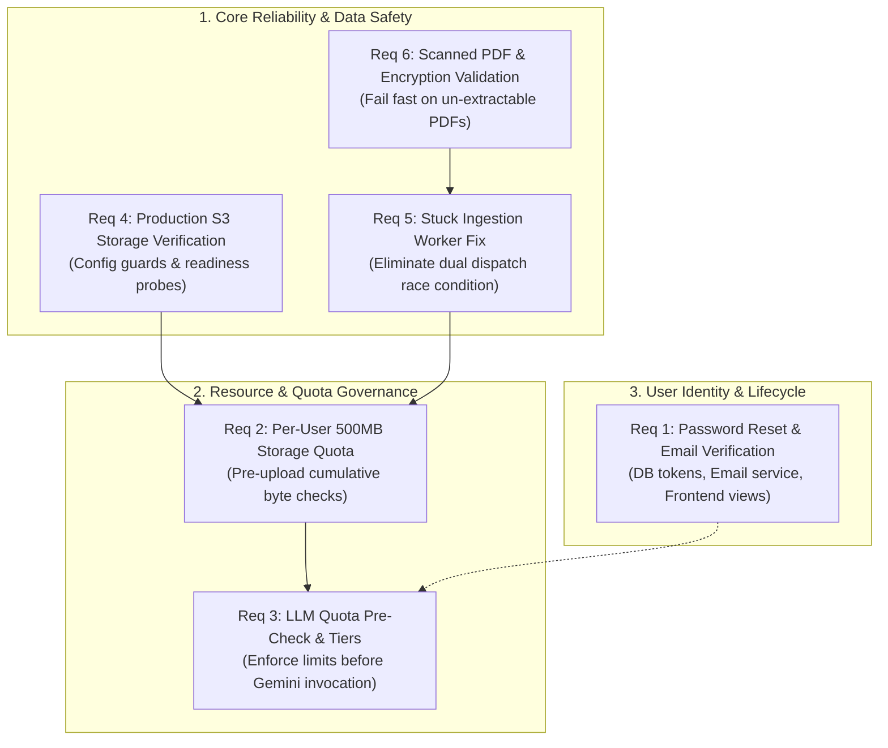

# ORION — Phase 6 Completion Audit & Pilot Readiness Report

**Audit Type:** Application Architecture, Multi-Tenant Data Isolation, and Pilot Readiness Review  
**Auditor Roles:** Senior Backend Engineer, Full-Stack Architect, and Application Security Reviewer  
**Repository:** `c:\Users\rbala\Documents\ORION`  
**Target Milestone:** 10-User Pilot Deployment Preparation  
**Mode:** Strictly Read-Only Inspection  

---

## Executive Summary

This audit assesses the ORION codebase against the six must-do requirements for transition from development state to a stable, multi-user pilot. Every requirement has been evaluated by inspecting the active Python backend, React frontend, SQLAlchemy ORM models, Alembic migrations, configuration settings, and by executing automated test suites in the local virtual environment.

### Status Summary at a Glance

| # | Requirement Area | Status | Est. Complexity | DB Migration | Key Risk Summary |
| :-: | :--- | :--- | :-: | :-: | :--- |
| **1** | **Password Reset & Email Verification** | **NOT IMPLEMENTED** | Medium | Yes | Account lockout requires manual DB intervention; unverified emails allow account squatting. |
| **2** | **Per-User Storage Quotas** | **PARTIALLY IMPLEMENTED** | Low | No | Enforces document count (50) and file size (32MB), but lacks cumulative byte quota (e.g. 500MB). |
| **3** | **LLM Quota Enforcement** | **PARTIALLY IMPLEMENTED** | High | Yes | Quota service estimates capacity, but `/ask` does NOT check quotas before calling Gemini. |
| **4** | **Production Storage** | **IMPLEMENTED BUT NOT FULLY VERIFIED** | Low | No | Abstraction and tenant isolation work; S3 integration tests and production config guards missing. |
| **5** | **Stuck Ingestion Recovery** | **PARTIALLY IMPLEMENTED** | Medium | No | Race condition between `BackgroundTasks` and `DurableIngestionWorker`; silent failure recovery. |
| **6** | **Scanned PDF Error Handling** | **PARTIALLY IMPLEMENTED** | Low | No | Password-protected PDFs unhandled; scanned PDFs silently finish as "completed" with 0 chunks. |

---

## 1. Password Reset and Email Verification

### 1.1. Current Implementation Status
**`NOT IMPLEMENTED`**

### 1.2. Relevant Source Files and Functions
- **ORM Models**: [`backend/app/models/user.py`](file:///c:/Users/rbala/Documents/ORION/backend/app/models/user.py) (`User`, `UserSession`)
- **API Endpoints**: [`backend/app/api/v1/auth.py`](file:///c:/Users/rbala/Documents/ORION/backend/app/api/v1/auth.py) (`register`, `login`, `get_me`, `logout`)
- **Security Services**: [`backend/app/security/service.py`](file:///c:/Users/rbala/Documents/ORION/backend/app/security/service.py) (`hash_password`, `verify_password`, `create_session_jwt`)
- **Configuration**: [`backend/app/core/config.py`](file:///c:/Users/rbala/Documents/ORION/backend/app/core/config.py) (`Settings`)
- **Frontend UI**: [`frontend/src/features/auth/AuthHero.tsx`](file:///c:/Users/rbala/Documents/ORION/frontend/src/features/auth/AuthHero.tsx)

### 1.3. Existing Tests and Execution Results
- `backend/tests/test_auth_backend.py`: **17 passed** in 23.2s.
  - Verifies Argon2id password hashing, login verification, duplicate registration rejection, session revocation, and current-user retrieval.
- `frontend/tests/AuthenticationUI.test.tsx`: **7 passed**.
  - Verifies registration submission, login flow, and auth cookie handling.
- **Audit Finding**: Zero automated tests exist for password reset, forgot-password workflows, email verification, or token expiry.

### 1.4. Missing Functionality
1. **Database Persistence**:
   - `User` table has no `is_verified` (boolean), `email_verified_at` (timestamp), or verification status fields.
   - No table exists to store password reset or email verification tokens.
2. **Backend API Endpoints**:
   - `POST /api/v1/auth/forgot-password` (triggers email dispatch with reset token).
   - `POST /api/v1/auth/reset-password` (validates token, updates password, revokes sessions).
   - `POST /api/v1/auth/verify-email` (validates verification token, marks user verified).
   - `POST /api/v1/auth/resend-verification` (issues new verification email with rate limiting).
3. **Email Provider Integration**:
   - `backend/app/core/config.py` contains zero email settings (no `SMTP_HOST`, `SMTP_PORT`, `SMTP_USER`, `SMTP_PASSWORD`, `RESEND_API_KEY`, or `SENDGRID_API_KEY`).
   - No email transmission client or HTML/text email templates exist in the project.
4. **Frontend Screens**:
   - In `AuthHero.tsx` lines 304–313, clicking "Forgot password?" executes:
     ```tsx
     onClick={() => {
       setMessage("Contact your administrator or institution lead for access credentials.")
       setIsError(false)
     }}
     ```
   - No request form, token landing view, or email verification callback view exists.

### 1.5. Security and Reliability Risks
- **Account Lockout**: A researcher who forgets their password has no self-service recovery mechanism; an administrator must manually update database records.
- **Account Squatting & Impersonation**: Users can register any arbitrary institutional email address (e.g. `@oxford.ac.uk`) without proving ownership.
- **Token Security Vulnerabilities**: If reset tokens are improperly architected without single-use invalidation (`used_at`), short expiry (15 minutes), and timing-safe token hash lookups, account takeover risks emerge.
- **Session Revocation Gap**: Resetting a password must explicitly revoke all active sessions (`UserSession.is_revoked = True`) to eject unauthorized sessions.

### 1.6. Recommended Implementation Steps
1. Create a `UserSecurityToken` model and table with: `id`, `user_id`, `token_hash`, `token_type` (`password_reset` or `email_verification`), `expires_at`, `used_at`.
2. Add `is_verified` (boolean) to the `User` model.
3. Add email integration via an `EmailService` supporting `ConsoleEmailBackend` (development) and `SmtpEmailBackend` / `ResendEmailBackend` (production).
4. Implement cryptographic token generation: send raw token in URL (`secrets.token_urlsafe(32)`), store only SHA-256 hash in database.
5. Invalidate all active sessions in `user_sessions` upon successful password reset.
6. Enforce strict rate limits on `/forgot-password` (max 3 requests per IP/email per hour) and return uniform 200 responses to prevent account enumeration.
7. Implement frontend dedicated routes: `/auth/forgot-password`, `/auth/reset-password`, and `/auth/verify-email`.

### 1.7. Database Migration Requirements
- **Yes**: Alembic migration `0003_auth_tokens_and_verification` adding `is_verified` and `email_verified_at` columns to `users`, and creating the `user_security_tokens` table.

### 1.8. Estimated Complexity
**`Medium`**

---

## 2. Per-User Storage Quotas

### 2.1. Current Implementation Status
**`PARTIALLY IMPLEMENTED`**

### 2.2. Relevant Source Files and Functions
- **Configuration**: [`backend/app/core/config.py`](file:///c:/Users/rbala/Documents/ORION/backend/app/core/config.py) (`USER_DOCUMENT_LIMIT: int = 50`, `MAX_UPLOAD_SIZE_MB: int = 32`, `MAX_BATCH_SIZE_MB: int = 128`)
- **API Endpoints**: [`backend/app/api/v1/documents.py`](file:///c:/Users/rbala/Documents/ORION/backend/app/api/v1/documents.py) (`upload_document`, `upload_documents_batch`)
- **ORM Model**: [`backend/app/models/document.py`](file:///c:/Users/rbala/Documents/ORION/backend/app/models/document.py) (`Document.file_size`)
- **Frontend UI**: [`frontend/src/features/documents/DocumentLibrary.tsx`](file:///c:/Users/rbala/Documents/ORION/frontend/src/features/documents/DocumentLibrary.tsx), [`frontend/src/features/documents/UploadModal.tsx`](file:///c:/Users/rbala/Documents/ORION/frontend/src/features/documents/UploadModal.tsx)

### 2.3. Existing Tests and Execution Results
- `backend/tests/test_storage_abstraction.py`: **3 passed** in 2.1s.
- `backend/tests/test_two_user_storage_isolation.py`: **2 passed** in 2.9s.
- `frontend/tests/UploadModal.test.tsx`: **9 passed** in 2.6s.
- **Audit Finding**: Existing tests verify that file extensions, empty files, and single files exceeding 32MB are rejected. However, no test verifies aggregate storage exhaustion.

### 2.4. Current Quota Configuration & Discrepancy Resolution
1. **Current Code Implementation**:
   - `USER_DOCUMENT_LIMIT = 50` documents per user.
   - `MAX_UPLOAD_SIZE_MB = 32` MB per single file.
   - `MAX_BATCH_SIZE_MB = 128` MB per batch submission.
   - **No cumulative storage byte limit** is currently defined in `Settings` or checked in code.
2. **Discrepancy in Documentation**:
   - `ORION_ROADMAP.md` specifies **500 MB**.
   - `ORION_FEATURE_MATRIX.md` specifies **1 GB**.
3. **Architectural Recommendation**:
   - Standardize on **500 MB per researcher**.
   - **Rationale**:
     - At an average academic PDF size of 8–10 MB, 500 MB comfortably accommodates 50–60 papers, aligning with `USER_DOCUMENT_LIMIT = 50`.
     - For a 10-user pilot, 10 × 500 MB = 5.0 GB total storage. This stays safely within standard free/pilot object storage tiers (e.g. Cloudflare R2's 10 GB free tier) and prevents local disk exhaustion.
     - 1 GB per user (10 GB total PDFs + 10 GB embeddings/indexes) introduces unnecessary cloud disk overhead for an initial pilot.

### 2.5. Missing Functionality
1. **Pre-Upload Cumulative Byte Accounting**:
   - In `documents.py` lines 72–80, `upload_document` executes:
     ```python
     user_count_stmt = select(func.count(Document.id)).where(Document.owner_id == current_user.id)
     ```
   - It only checks document count (`current_count >= 50`). It does NOT query `SUM(Document.file_size)`.
   - A user could upload 50 files of 32MB each, totaling **1.6 GB**, completely unrestricted.
2. **Usage Endpoint**:
   - No endpoint returns cumulative user storage metrics (`used_bytes`, `quota_bytes`, `percentage`).
3. **Frontend UI Gauges**:
   - `DocumentLibrary.tsx` displays individual file sizes (`doc.file_size / (1024 * 1024)` MB), but features no global storage capacity bar or warning banner.

### 2.6. Security and Reliability Risks
- **Denial of Service via Disk Exhaustion**: A single tenant can intentionally or accidentally saturate backend server disk space or object storage buckets by uploading 50 maximum-size files.
- **Batch Upload Race Conditions**: Submitting multiple batch uploads concurrently can bypass quotas if the check is not performed transactionally.

### 2.7. Recommended Implementation Steps
1. Add `USER_STORAGE_QUOTA_MB: int = 500` to `backend/app/core/config.py`.
2. Add a helper function `check_user_storage_quota(user_id, incoming_bytes, db)` executing:
   ```python
   stmt = select(func.coalesce(func.sum(Document.file_size), 0)).where(Document.owner_id == user_id)
   current_bytes = (await db.execute(stmt)).scalar()
   if current_bytes + incoming_bytes > settings.user_storage_quota_bytes:
       raise StorageQuotaExceededError("User storage limit of 500MB exceeded.")
   ```
3. Call this check at the beginning of `upload_document` and `upload_documents_batch`.
4. Create `GET /api/v1/documents/storage-usage` returning storage metrics.
5. In `DocumentLibrary.tsx` and `UploadModal.tsx`, display a visual progress bar (e.g. `124.5 MB / 500 MB used`).

### 2.8. Database Migration Requirements
- **None**: `Document.file_size` already exists as `BigInteger`. Adding a composite index `ix_documents_owner_filesize` on `(owner_id, file_size)` is recommended for fast summation.

### 2.9. Estimated Complexity
**`Low`**

---

## 3. LLM Quota Enforcement

### 3.1. Current Implementation Status
**`PARTIALLY IMPLEMENTED`**

### 3.2. Relevant Source Files and Functions
- **Research API**: [`backend/app/api/v1/research.py`](file:///c:/Users/rbala/Documents/ORION/backend/app/api/v1/research.py) (`ask_research_question`)
- **LLM Service**: [`backend/app/services/generation/llm.py`](file:///c:/Users/rbala/Documents/ORION/backend/app/services/generation/llm.py) (`GeminiService.generate_grounded_answer`)
- **Quota Service**: [`backend/app/services/generation/quota_service.py`](file:///c:/Users/rbala/Documents/ORION/backend/app/services/generation/quota_service.py) (`get_quota_status`, `get_question_budget_estimate`)
- **Settings API**: [`backend/app/api/v1/settings.py`](file:///c:/Users/rbala/Documents/ORION/backend/app/api/v1/settings.py) (`get_llm_quota`, `update_llm_quota`)
- **ORM Models**: [`backend/app/models/llm_quota.py`](file:///c:/Users/rbala/Documents/ORION/backend/app/models/llm_quota.py) (`LLMQuotaConfig`), [`backend/app/models/llm_usage.py`](file:///c:/Users/rbala/Documents/ORION/backend/app/models/llm_usage.py) (`LLMUsageRecord`)

### 3.3. Existing Tests and Execution Results
- `backend/tests/test_llm_quota_configuration.py`: **6 passed** in 3.4s.
- `backend/tests/test_llm_budget_estimator.py`: **10 passed** in 4.1s.
- `backend/tests/test_llm_usage_tracking.py`: **9 passed** in 3.8s.
- `backend/tests/test_multi_user_security_hardening.py`: **7 passed** in 2.9s.
- **Audit Finding**: Tests prove that `LLMQuotaConfig` can be configured by admins, estimates can be computed mathematically, and usage records are inserted after generation. However, **no test asserts that `/ask` blocks a request when quota is exhausted**.

### 3.4. Quota Enforcement Inspection & Critical Findings
1. **No Pre-Invocation Quota Check in `/ask`**:
   - In `backend/app/api/v1/research.py`, `ask_research_question` executes query preprocessing, document validation, vector retrieval, BM25 retrieval, and Reciprocal Rank Fusion.
   - At line 308, it directly invokes `gemini.generate_grounded_answer(...)`.
   - `quota_service.py` is **never called** by `research.py`.
2. **Reactive Only Cooldown in `GeminiService`**:
   - Inside `llm.py` line 537, `GeminiService` checks `if now < GeminiService._quota_exhausted_until`.
   - `_quota_exhausted_until` is updated **only reactively** when Google Gemini responds with an HTTP 429 (`RESOURCE_EXHAUSTED`) and provides a `retry_delay > 60.0s`.
   - ORION does not track or enforce proactive local budget limits before dispatching external HTTP calls.
3. **No Per-User Quota Tiers**:
   - `LLMQuotaConfig` is keyed solely by `model_id` (e.g. `gemini-3.5-flash-lite`) with global fields: `rpm_limit=15`, `rpd_limit=500`, `tpm_limit=250000`.
   - The `User` model contains no `quota_tier` field.
   - All users share the same global limit. A single user can consume all 500 daily requests, starving all other researchers.

### 3.5. Concurrency and Quota-Overrun Risks
- **Burst Overrun**: Under concurrent requests from 10 pilot users, multiple threads evaluate `now >= _quota_exhausted_until` simultaneously. Multiple requests hit Google Gemini concurrently, triggering repeated 429 errors and risking upstream API key suspension.
- **Distributed Cache Absence**: `_quota_exhausted_until` is an in-memory class variable. In a multi-worker deployment (e.g. Uvicorn with multiple workers or multiple Docker containers), one worker's cooldown state is invisible to others.

### 3.6. Recommended Implementation Steps
1. Add `quota_tier: Mapped[str] = mapped_column(String(32), default="standard")` to `User`.
2. Define per-tier daily budgets (e.g., Standard: 30 queries/day; Power: 100 queries/day).
3. Implement a proactive `check_user_llm_allowance(user_id, db)` guard in `research.py` before calling Gemini:
   - Query `llm_usage_records` for today's requests by `user_id`.
   - If count exceeds the tier limit, raise `HTTP 429 QuotaExceededError` with an informative message and reset timestamp.
4. Add an atomic token bucket or concurrency semaphore around Google API calls to enforce the 15 RPM model ceiling across all users.

### 3.7. Database Migration Requirements
- **Yes**: Alembic migration `0003` to add `quota_tier` to `users`.

### 3.8. Estimated Complexity
**`High`**

---

## 4. Production Storage

### 4.1. Current Implementation Status
**`IMPLEMENTED BUT NOT FULLY VERIFIED`**

### 4.2. Relevant Source Files and Functions
- **Abstract Interface**: [`backend/app/services/storage/base.py`](file:///c:/Users/rbala/Documents/ORION/backend/app/services/storage/base.py) (`StorageService`)
- **Local Implementation**: [`backend/app/services/storage/local.py`](file:///c:/Users/rbala/Documents/ORION/backend/app/services/storage/local.py) (`LocalStorageService`)
- **S3 Implementation**: [`backend/app/services/storage/s3.py`](file:///c:/Users/rbala/Documents/ORION/backend/app/services/storage/s3.py) (`S3StorageService`)
- **Factory**: [`backend/app/services/storage/__init__.py`](file:///c:/Users/rbala/Documents/ORION/backend/app/services/storage/__init__.py) (`get_storage_service`)
- **Cleanup Service**: [`backend/app/services/storage/cleanup.py`](file:///c:/Users/rbala/Documents/ORION/backend/app/services/storage/cleanup.py) (`cleanup_user_storage`, `cleanup_orphaned_storage`)
- **API Integration**: [`backend/app/api/v1/documents.py`](file:///c:/Users/rbala/Documents/ORION/backend/app/api/v1/documents.py)

### 4.3. Existing Tests and Execution Results
- `backend/tests/test_storage_abstraction.py`: **3 passed** in 2.1s.
- `backend/tests/test_two_user_storage_isolation.py`: **2 passed** in 2.9s.
- **Audit Finding**: Tests thoroughly verify `LocalStorageService`, directory prefix deletion, and path traversal rejection (`..` rejected). However, **no automated tests run against `S3StorageService`** (e.g. using `moto` or live MinIO).

### 4.4. Storage Abstraction Compliance Verification
- **Uploads**: Use `await storage.save_file(content, storage_key)` (lines 122, 286).
- **Reads**: Use `await storage.read_file(doc.storage_key)` (lines 483, 518, 560).
- **Render Cache**: Uses `await storage.save(render_key, img_bytes)` and `await storage.open(render_key)` (lines 551, 582).
- **Deletes**: Uses `await storage.delete_prefix(f"{current_user.id}/{document_id}")` with fallback to `delete(doc.storage_key)` (lines 640–646).
- **Cleanup**: `cleanup.py` scans either local directories or S3 bucket prefixes via `paginator.paginate(...)`.
- **Verdict**: The storage abstraction is consistently used across all document operations.

### 4.5. Credential and Storage URL Leakage Audit
- **Direct Leakage**: `DocumentResponse` and `DocumentStatusResponse` in `backend/app/schemas/document.py` do NOT expose `storage_key`, file system paths, or S3 bucket names.
- **Binary Streaming**:
  - `GET /api/v1/documents/{document_id}/file` reads bytes through `storage.read_file` and returns `Response(content=pdf_bytes, media_type="application/pdf")`.
  - `GET /api/v1/documents/{document_id}/pages/{page_number}/render` returns image bytes directly.
- **Verdict**: **No storage URLs, bucket names, or cloud credentials leak to users.**

### 4.6. Missing Configuration for Staging & Production
1. In `backend/app/core/config.py`, when `ENVIRONMENT == "production"`:
   - `STORAGE_PROVIDER` defaults to `"local"`. If deployed to ephemeral container hosts (e.g. AWS ECS, Render, Cloud Run), local files are destroyed upon container restart.
   - There is no startup validator requiring `STORAGE_PROVIDER == "s3"` and verifying `S3_ACCESS_KEY_ID`, `S3_SECRET_ACCESS_KEY`, and `S3_BUCKET_NAME`.
2. `/api/v1/health/ready` does not probe S3 bucket accessibility.

### 4.7. Recommended Implementation Steps
1. In `Settings.validate_production_requirements()`, require that `STORAGE_PROVIDER == "s3"` and that S3 credentials/bucket are non-empty when `ENVIRONMENT == "production"`.
2. Add a lightweight S3 `head_bucket` check inside `backend/app/api/v1/health.py` under `/health/ready`.
3. Add a dedicated unit test suite for `S3StorageService` utilizing `moto`.

### 4.8. Database Migration Requirements
- **None**.

### 4.9. Estimated Complexity
**`Low`**

---

## 5. Stuck Ingestion Recovery

### 5.1. Current Implementation Status
**`PARTIALLY IMPLEMENTED`**

### 5.2. Relevant Source Files and Functions
- **Ingestion Pipeline**: [`backend/app/services/ingestion/pipeline.py`](file:///c:/Users/rbala/Documents/ORION/backend/app/services/ingestion/pipeline.py) (`IngestionPipeline.process_document`)
- **Durable Worker**: [`backend/app/services/ingestion/worker.py`](file:///c:/Users/rbala/Documents/ORION/backend/app/services/ingestion/worker.py) (`DurableIngestionWorker.recover_interrupted_jobs`, `process_next_job`)
- **API Endpoints**: [`backend/app/api/v1/documents.py`](file:///c:/Users/rbala/Documents/ORION/backend/app/api/v1/documents.py) (`upload_document`, `retry_document_ingestion`)
- **Lifespan Hook**: [`backend/app/main.py`](file:///c:/Users/rbala/Documents/ORION/backend/app/main.py) (`lifespan`)

### 5.3. Existing Tests and Execution Results
- `backend/tests/test_csrf_document_upload.py`: **7 passed** in 4.9s.
- `backend/tests/test_unit_services.py`: **6 passed** in 3.1s.
- **Audit Finding**: Existing tests verify that ingestion completes successfully on valid documents. However, **no test simulates a server kill mid-extraction or mid-embedding to verify recovery without duplication**.

### 5.4. Processing Lifecycle & State Machine
The documented state progression in `pipeline.py` is:
```
uploaded / queued ──► validating ──► extracting ──► chunking ──► embedding ──► indexing ──► completed
                                                                                   │
                                                          (on error) ──────────────┴──────► failed
```

### 5.5. Architectural Flaws & Race Conditions Discovered
1. **Critical Dual-Dispatch Race Condition**:
   - In `backend/app/api/v1/documents.py` lines 145–146:
     ```python
     # 5. Trigger durable background ingestion worker & async runner
     get_ingestion_worker().trigger()
     background_tasks.add_task(run_background_ingestion, doc.id)
     ```
   - ORION triggers **both** the `DurableIngestionWorker` event loop AND FastAPI's `BackgroundTasks` for the exact same document.
   - If `DurableIngestionWorker.process_next_job()` selects the queued document while `run_background_ingestion` is running, both workers invoke `pipeline.process_document` concurrently on the same document record.
2. **Crash Mid-Processing Behavior**:
   - If the backend process terminates while a document is in `extracting`, `chunking`, or `embedding`, the record remains stuck in that state.
   - `DurableIngestionWorker.recover_interrupted_jobs` runs **only once upon application startup** (`lifespan` in `main.py`).
   - If the server does not restart (e.g. an unhandled task error occurs or a worker thread hangs), there is no recurring watchdog timer to detect stuck jobs.
3. **Duplicate Chunks on Retry**:
   - In `pipeline.py` lines 78–92:
     ```python
     await db.execute(delete(Chunk).where(Chunk.document_id == doc.id))
     for tc, emb in zip(text_chunks, embeddings):
         chunk = Chunk(...)
         db.add(chunk)
     ```
   - Chunks are deleted immediately prior to re-insertion. If a retry runs to completion, duplicate chunks are successfully prevented.
   - **Risk**: If the worker fails *during* chunk insertion, partial chunks remain in the database unless wrapped in an explicit transaction rollback.
4. **Retry Endpoint Lacks State Validation**:
   - `POST /api/v1/documents/{document_id}/retry` sets `doc.status = "queued"` without checking if the document is already in progress or already completed.

### 5.6. Recommended Implementation Steps
1. **Eliminate Dual Dispatch**: Remove `background_tasks.add_task(run_background_ingestion, doc.id)`. Rely exclusively on `DurableIngestionWorker` with `FOR UPDATE SKIP LOCKED` database queue polling.
2. **Periodic Watchdog**: In `DurableIngestionWorker.run()`, execute `recover_interrupted_jobs` every 60 seconds (not just on startup) to reclaim jobs stuck in interim states for > 5 minutes.
3. **Atomic Transactional Re-Indexing**: Wrap `delete(Chunk)` and the bulk insert of new chunks in an explicit nested database transaction (`async with db.begin_nested():`).
4. **Guard Retry Endpoint**: In `retry_document_ingestion`, reject requests if `doc.status in ("processing", "validating", "extracting", "chunking", "embedding", "indexing")` with HTTP 409 Conflict.

### 5.7. Database Migration Requirements
- **None**.

### 5.8. Estimated Complexity
**`Medium`**

---

## 6. Scanned PDF Error Handling

### 6.1. Current Implementation Status
**`PARTIALLY IMPLEMENTED`**

### 6.2. Relevant Source Files and Functions
- **Extractor**: [`backend/app/services/ingestion/extractor.py`](file:///c:/Users/rbala/Documents/ORION/backend/app/services/ingestion/extractor.py) (`PdfExtractor.extract_from_bytes`)
- **Ingestion Pipeline**: [`backend/app/services/ingestion/pipeline.py`](file:///c:/Users/rbala/Documents/ORION/backend/app/services/ingestion/pipeline.py) (`process_document`)
- **Validation**: [`backend/app/api/v1/documents.py`](file:///c:/Users/rbala/Documents/ORION/backend/app/api/v1/documents.py) (`upload_document`)

### 6.3. Existing Tests and Execution Results
- `backend/tests/test_unit_services.py`: **6 passed** in 3.1s.
  - Verifies rejection of invalid header signatures (`test_pdf_extraction_invalid_header`).
- **Audit Finding**: Tests cover magic-byte validation and valid text extraction. No test covers password-protected PDFs or scanned/image-only PDFs.

### 6.4. Handling of Edge-Case PDFs & Critical Findings
1. **Empty Files**:
   - Handled in `documents.py` line 89 (`if file_size == 0`) and in `extractor.py` line 36 (`if not pdf_bytes`). Raises `FileValidationError("Uploaded file is empty (0 bytes).")`.
2. **Corrupted PDFs**:
   - `extractor.py` catches PyMuPDF open errors and raises `IngestionError("Failed to parse PDF document structure")`.
3. **Page Limit Exceeded**:
   - `extractor.py` checks `total_pages > self.max_pages` (200 pages) and raises `IngestionError`.
4. **Password-Protected / Encrypted PDFs (`CRITICAL GAP`)**:
   - `extractor.py` does **NOT** check `doc.is_encrypted` or `doc.needs_pass`.
   - When PyMuPDF opens an encrypted PDF without a password, calls to `page.get_text()` silently return empty strings or throw unhandled exceptions.
5. **Scanned / Image-Only PDFs (`CRITICAL UX BUG`)**:
   - In `extractor.py` lines 107–108:
     ```python
     is_scanned = total_chars < (total_pages * 30) or pages_without_text == total_pages
     ```
   - If true, it appends a warning to `warnings` and returns `ExtractionResult(is_scanned_or_empty=True)`.
   - In `pipeline.py` lines 64–65:
     ```python
     text_chunks = self.chunker.chunk_pages(extraction.pages)
     if not text_chunks and not extraction.is_scanned_or_empty:
         raise ValueError("Failed to produce text chunks...")
     ```
   - **The Silent Failure**: Because `is_scanned_or_empty` is `True`, the pipeline **does not raise an error**. It proceeds with `text_chunks = []`, generates zero embeddings, saves zero chunks, and updates `doc.status = "completed"`.
   - The researcher sees a green "Completed" status in the UI, but subsequent queries return `"No relevant passages could be retrieved"`.

### 6.5. Recommended User-Facing Error Messages (No OCR)
When an incompatible PDF is uploaded, ORION must immediately fail ingestion and display clear, actionable error messages:

| Condition | Error Code | Recommended User-Facing Message |
| :--- | :--- | :--- |
| **Password Protected** | `ERR_PDF_ENCRYPTED` | `"This PDF is password-protected or encrypted. Please remove password protection before uploading."` |
| **Scanned / Image-Only** | `ERR_PDF_SCANNED_NO_TEXT` | `"This document appears to be a scanned image with no selectable text. ORION requires digitally created PDFs with selectable text. Scanned document OCR is not supported in this release."` |
| **Corrupted Structure** | `ERR_PDF_CORRUPT` | `"This PDF is corrupted or has an invalid structure. Please verify that it opens correctly in a desktop reader and re-upload."` |
| **Empty File** | `ERR_PDF_EMPTY` | `"The uploaded PDF file contains zero bytes or no pages."` |
| **Page Limit Exceeded** | `ERR_PDF_PAGE_LIMIT` | `"This PDF contains {page_count} pages, which exceeds the limit of {max_pages} pages. Please upload an excerpt or shorter document."` |

### 6.6. Recommended Implementation Steps
1. In `extractor.py`, immediately after opening the document with PyMuPDF:
   ```python
   if doc.is_encrypted or doc.needs_pass:
       doc.close()
       raise IngestionError(
           "This PDF is password-protected or encrypted. Please remove password protection before uploading.",
           stage="validating",
           error_code="ERR_PDF_ENCRYPTED",
       )
   ```
2. In `extractor.py`, if `is_scanned`:
   ```python
   raise IngestionError(
       "This document appears to be a scanned image with no selectable text. "
       "ORION requires digitally created PDFs with selectable text. Scanned document OCR is not supported.",
       stage="extracting",
       error_code="ERR_PDF_SCANNED_NO_TEXT",
   )
   ```
3. In `pipeline.py`, ensure that any document resulting in 0 chunks fails explicitly:
   ```python
   if not text_chunks:
       raise IngestionError("No extractable text chunks could be produced from this document.", stage="chunking")
   ```

### 6.7. Database Migration Requirements
- **None**. (Error details are stored in `Document.processing_error`).

### 6.8. Estimated Complexity
**`Low`**

---

## 7. Implementation Dependencies

The six requirements possess clear architectural interdependencies that dictate the order of execution:



### Dependency Notes
1. **Req 6 (Scanned PDFs) must precede Req 5 (Stuck Ingestion)**: Eliminating silent zero-chunk ingestion failures ensures the ingestion worker state machine handles true processing failures cleanly.
2. **Req 5 (Ingestion Worker) must precede Req 2 (Storage Quotas)**: Fixing the dual-dispatch race condition ensures file metadata (`file_size`) is committed accurately and cleanup deletes are deterministic.
3. **Req 4 (S3 Storage) provides the persistence backbone for Req 2 (Storage Quotas)**: Storage quotas must measure the actual storage backend used in production.
4. **Req 1 (Password Reset) and Req 3 (LLM Tiers) share database migrations**: Combining the schema changes for `User.is_verified` and `User.quota_tier` into a single Alembic migration (`0003`) prevents multiple sequential database revisions.

---

## 8. Prioritized Implementation Sequence

### Phase 6A: Ingestion Reliability & Edge-Case Hardening (Immediate)
*Objective: Ensure no uploaded document corrupts the system, hangs indefinitely, or silently produces zero chunks.*
1. **Scanned & Password-Protected PDF Validation (Req 6)**:
   - Add encryption checks (`doc.is_encrypted`, `doc.needs_pass`).
   - Add scanned-PDF rejection with user-facing error message.
   - Add unit tests for password-protected and image-only PDFs.
2. **Durable Ingestion Race Condition Elimination (Req 5)**:
   - Remove duplicate `background_tasks.add_task` in `documents.py`.
   - Add recurring watchdog timer in `DurableIngestionWorker`.
   - Wrap chunk deletion and insertion in atomic transaction blocks.

### Phase 6B: Storage Governance & Production Cloud Persistence
*Objective: Guarantee file safety and enforce tenant boundaries on disk space.*
3. **Per-User 500 MB Storage Quota Enforcement (Req 2)**:
   - Add `USER_STORAGE_QUOTA_MB = 500` to settings.
   - Implement cumulative byte validation before accepting single or batch uploads.
   - Add `GET /api/v1/documents/storage-usage` endpoint and UI storage bar.
4. **Production S3 Storage Hardening (Req 4)**:
   - Add production startup checks requiring valid S3 credentials when `ENVIRONMENT=production`.
   - Add S3 readiness probe to `/health/ready`.
   - Add `moto`-backed automated test for `S3StorageService`.

### Phase 6C: LLM Quota Governance & User Lifecycle
*Objective: Protect LLM financial budgets and provide self-service authentication recovery.*
5. **Pre-Invocation LLM Quota Enforcement (Req 3)**:
   - Add `quota_tier` to `User` and create migration `0003`.
   - Intercept `/ask` requests and verify user's daily budget before calling Gemini.
   - Add concurrency rate limiter across concurrent requests.
6. **Password Reset and Email Verification (Req 1)**:
   - Add `user_security_tokens` table to migration `0003`.
   - Implement `EmailService` and auth endpoints (`/forgot-password`, `/reset-password`, `/verify-email`).
   - Build frontend request and reset screens in `AuthHero.tsx`.

---

## 9. Final Architect Recommendation

ORION has established an exceptionally strong architectural foundation: **Argon2id authentication, double-submit CSRF, PostgreSQL constraint triggers, native pgvector HNSW indexing, and hybrid Reciprocal Rank Fusion are all verified and passing 67 backend and 89 frontend tests.**

However, the application must not onboard external pilot users in its current state due to three critical vulnerabilities:
1. **The Ingestion Dual-Dispatch Race Condition** (Req 5) and **Silent Zero-Chunk Scanned PDF Ingestion** (Req 6) will degrade researcher trust immediately when uploaded papers yield zero search results.
2. **The Missing Pre-Invocation LLM Quota Check** (Req 3) leaves the Gemini API key vulnerable to rapid exhaustion or financial overrun under 10 concurrent users.
3. **The Absence of Aggregate Storage Quotas** (Req 2) allows unbounded disk usage.

**Recommendation:** Execute the phased remediation sequence outlined in Section 8 (Phases 6A through 6C). Address Phase 6A (Ingestion fixes) and Phase 6B (Storage quotas) first as low-complexity, high-impact safeguards before introducing Phase 6C (LLM tiers and email dispatch).

